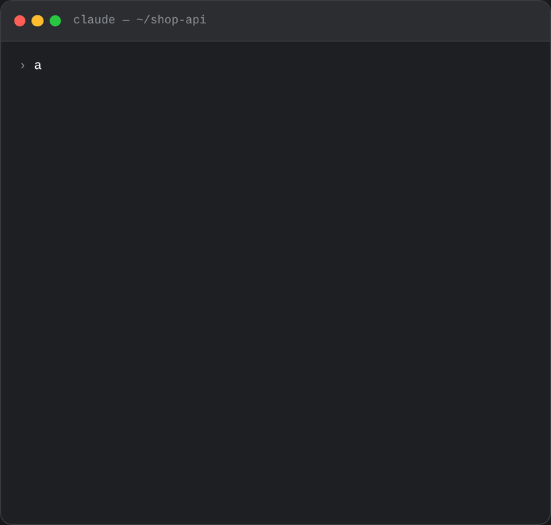
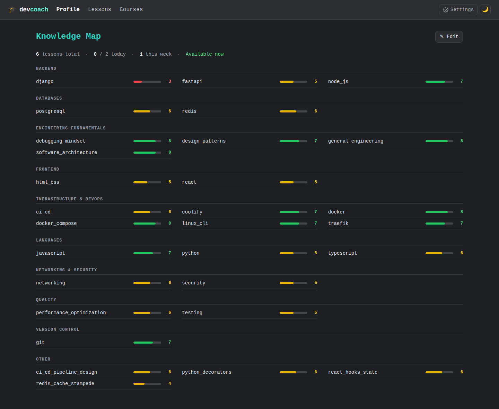
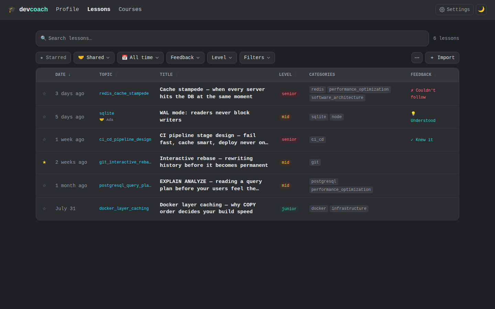
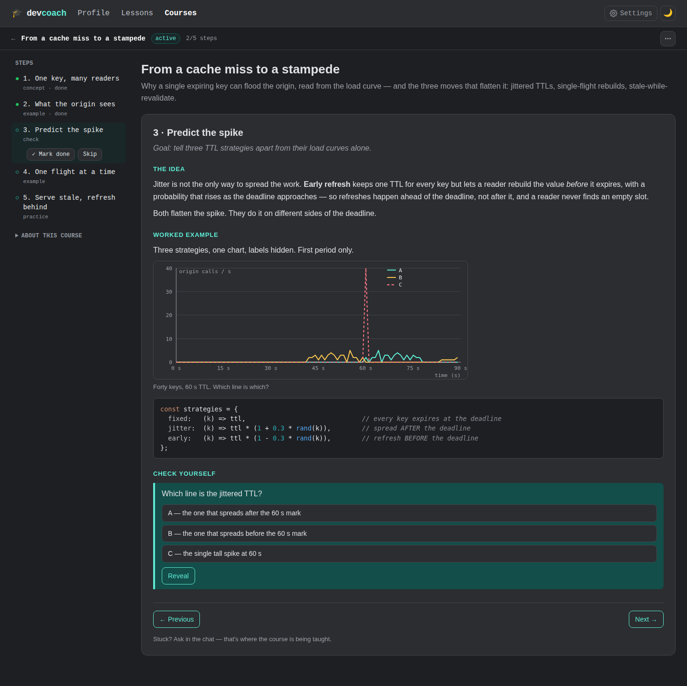

# devcoach

<p align="center">
  <a href="https://ultimaphoenix.github.io/dev-coach/">
    
  </a>
</p>

[](https://www.npmjs.com/package/devcoach)
[](https://github.com/UltimaPhoenix/dev-coach/actions/workflows/ci.yml?query=branch%3Adevelop)
[](https://sonarcloud.io/summary/new_code?id=UltimaPhoenix_dev-coach)
[](https://sonarcloud.io/summary/new_code?id=UltimaPhoenix_dev-coach)
[](https://nodejs.org/)
[](https://ultimaphoenix.github.io/dev-coach/)
[](LICENSE)

**Stay sharp while your AI does the work.**

devcoach connects to Claude Code, Claude Desktop, Gemini CLI *(beta)*, Codex CLI *(beta)*, Cursor, Windsurf, and other MCP-compatible tools. When your agent finishes a task, devcoach teaches you one thing from it **that you don't know yet**: it keeps a map of what you already know precisely so it can skip it, and pitches each lesson at your level — no generic tutorials, no repeated topics, nothing to open.

<p align="center">
  
</p>

Everything runs **locally**. No data leaves your machine. One SQLite file at `~/.devcoach/coaching.db`.

---

## Install

Pick your agent. Each command wires up everything: the MCP server, the coaching hooks and the skill. Requires **Node.js ≥ 24**.

**Claude Code** — the plugin (recommended):

```bash
/plugin marketplace add UltimaPhoenix/claude-plugins-marketplace
/plugin install devcoach@ultimaphoenix
```

**Homebrew** — macOS / Linux, adds the `devcoach` CLI:

```bash
brew tap UltimaPhoenix/tap && brew trust --tap UltimaPhoenix/tap
brew install devcoach && devcoach install
```

**Windows** *(beta)* — one PowerShell line, brings its own Node.js and adds the `devcoach` CLI:

```powershell
irm https://ultimaphoenix.github.io/dev-coach/install.ps1 | iex
```

**npx** — any OS, for Claude Code and Claude Desktop:

```bash
npx -y devcoach install
```

| Also on | How |
|---|---|
| **Claude Desktop** *(beta)* | Download `devcoach-<version>.mcpb` from the [latest release](https://github.com/UltimaPhoenix/dev-coach/releases/latest) → Settings → Extensions → Install Extension… |
| **Scoop** *(Windows, beta)* | `scoop bucket add ultimaphoenix https://github.com/UltimaPhoenix/scoop-bucket`, then `scoop install devcoach && devcoach install` |
| **Gemini CLI** *(beta)* | `npx -y devcoach install --gemini` |
| **Codex CLI** *(beta)* | `npx -y devcoach install --codex` (approve the hooks once on the next run) |
| **Cursor, Windsurf, Cline, Continue, Zed** | Add `{ "mcpServers": { "devcoach": { "command": "npx", "args": ["-y", "devcoach", "mcp"] } } }` to the agent's MCP config, or install `io.github.UltimaPhoenix/devcoach` from the [MCP Registry](https://registry.modelcontextprotocol.io) |
| **claude.ai web** | No MCP there: paste [`assets/SKILL.md`](assets/SKILL.md) as custom instructions (coaching only, nothing saved) |

Two rules: with the plugin, **never also run `devcoach install`** (the hooks would count twice); after `brew upgrade`, `scoop update` or an npm update, **re-run `devcoach install`** to refresh the hooks and the skill (the Windows one-liner does it for you). Every method, step by step: **[Installation](docs/install/index.md)** · **[Windows](docs/install/windows.md)**.

---

## What happens next

1. **Onboarding in one pass.** The first time your agent connects, devcoach reads your local Claude Code history (file and activity metadata only, never prompt text) and builds your knowledge map, with no questions. Prefer to describe your stack yourself, or restore a backup? You can. → [Onboarding](docs/usage/coaching.md#onboarding)
2. **A lesson when one is due.** At most **2 a day, 4 hours apart**, one cue every ~10 interactions per chat session, never in plan mode. Every number is a setting. → [Configuration](docs/reference/configuration.md)
3. **One key to answer.** `y` knew it (the next lessons on that topic go deeper) · `u` understood · `n` couldn't follow (kept as the seed of a step-by-step [course](docs/usage/courses.md)). → [The feedback loop](docs/usage/coaching.md#the-feedback-loop)

Look back at all of it in the local dashboard (`devcoach ui`, or `/devcoach:ui` in Claude Code) or the [CLI](docs/usage/cli.md), and [share a lesson](docs/usage/sharing.md) with a teammate as text, a link or a file.

| Knowledge map | Lesson history | A course, one step at a time |
|:---:|:---:|:---:|
|  |  |  |

---

## Why devcoach?

AI agents now write much of our code — which makes it easy to ship more while understanding less. devcoach turns the tasks your agent finishes into short, in-context lessons on what you don't know yet, so you keep learning as you go. The deeper bet: as AI grows more capable, the scarce skill becomes *validating* what it produces — and that ability only survives if you keep practicing it.

→ [Why devcoach exists](docs/why.md)

**Privacy by design.** Everything stays on your machine. No telemetry, no accounts, no calls home. Just one SQLite file. → [Privacy & security](docs/reference/privacy.md)

---

## Documentation

The full guides live at **[ultimaphoenix.github.io/dev-coach](https://ultimaphoenix.github.io/dev-coach/)**:

- **[Coaching in your agent](docs/usage/coaching.md)** — onboarding, your first lesson, the feedback loop, what to expect
- **[Courses](docs/usage/courses.md)** · **[Sharing lessons](docs/usage/sharing.md)** · **[Web dashboard](docs/usage/web-ui.md)** · **[CLI reference](docs/usage/cli.md)**
- **[Installation](docs/install/index.md)** — every install method, agent by agent
- **[Configuration](docs/reference/configuration.md)** — rate limits, pacing, data location, schema
- **[How it works](docs/how-it-works.md)** — session startup, coaching loop, lesson selection
- **[Troubleshooting](docs/troubleshooting.md)** — `devcoach doctor`, common errors, known limitations, uninstalling
- **[MCP server reference](docs/reference/mcp-server.md)** · **[Privacy & security](docs/reference/privacy.md)** · **[FAQ](docs/faq.mdx)**
- **[Vision & roadmap](docs/vision.md)** — free, local, not commercialized; ideas we're exploring next

---

## Community & contributing

- **Star the repo** — help others discover it
- **[GitHub Issues](https://github.com/UltimaPhoenix/dev-coach/issues)** — feature requests, feedback and questions
- **[CONTRIBUTING.md](CONTRIBUTING.md)** — quick start, architecture rules, testing, branches & releases

Built on the official [Model Context Protocol TypeScript SDK](https://github.com/modelcontextprotocol/typescript-sdk), Node's embedded `node:sqlite`, [Hono](https://hono.dev) (web dashboard), and [Commander](https://github.com/tj/commander.js) (CLI).

---

## License

Copyright (C) 2026 [UltimaPhoenix](https://github.com/UltimaPhoenix)

devcoach is licensed under the [GNU Affero General Public License v3.0](LICENSE) (`AGPL-3.0-only`).
You may use, modify, and distribute it — **provided that any modified version you distribute, or run
as a network service, is also released as open source under the AGPL**. There is **no commercial
license on offer today**; if you need to embed devcoach in a closed-source product,
[open an issue](https://github.com/UltimaPhoenix/dev-coach/issues) and ask.

> **devcoach is and stays 100% free** to download, install, and use — for everyone, forever, including
> at work and on commercial projects. **Using devcoach does not put your code under the AGPL**: it runs
> as a separate process over stdio/MCP, so your own projects keep whatever license you choose.
> Examples and the details: **[License & commercial use](docs/reference/license.md)**.
