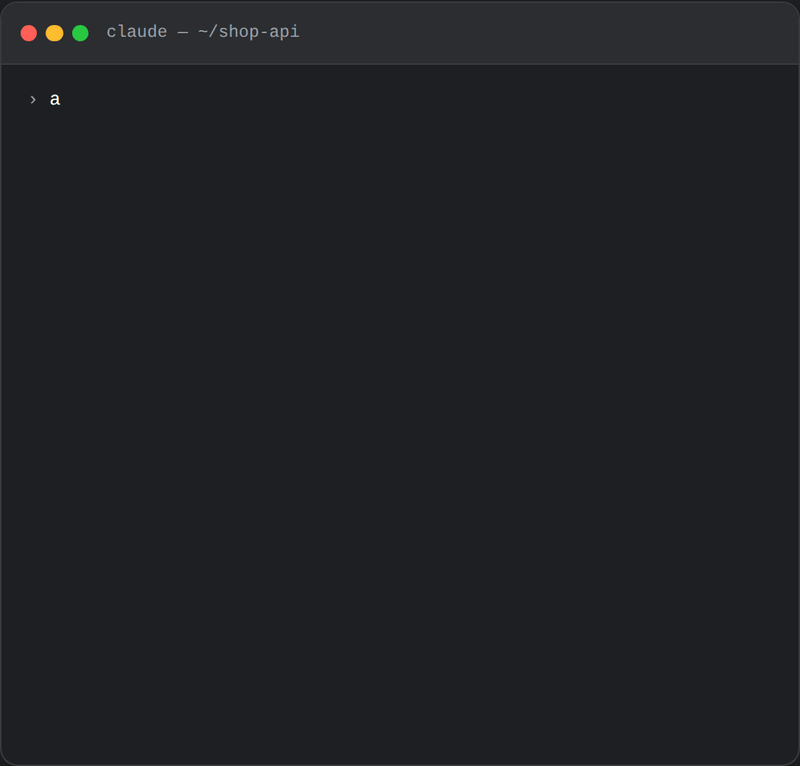
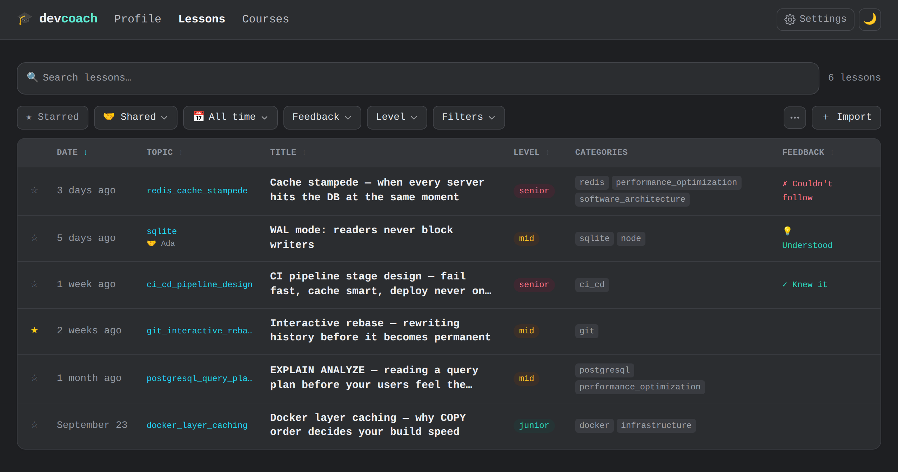

# devcoach

[](https://www.npmjs.com/package/devcoach)
[](https://github.com/UltimaPhoenix/dev-coach/actions/workflows/ci.yml?query=branch%3Adevelop)
[](https://sonarcloud.io/summary/new_code?id=UltimaPhoenix_dev-coach)
[](https://sonarcloud.io/summary/new_code?id=UltimaPhoenix_dev-coach)
[](https://nodejs.org/)
[](https://ultimaphoenix.github.io/dev-coach/)
[](https://github.com/UltimaPhoenix/dev-coach/blob/main/LICENSE)

**Learn from the code your AI writes.**

AI agents now write much of our code, which makes it easy to ship more while understanding less.
devcoach works inside Claude Code, Gemini CLI and Codex CLI: when your agent finishes a task and a
lesson is due, it teaches you one short lesson on something that task touched and you don't know yet,
pitched at your level. Free, open source and local: no account, no telemetry.

**Install in Claude Code** (needs Node.js 24 or newer). Type both lines in Claude Code:

```text
/plugin marketplace add UltimaPhoenix/claude-plugins-marketplace
/plugin install devcoach@ultimaphoenix
```

Another agent, or the `devcoach` command line? See [Install](#install).

<p align="center">
  
</p>

## Install

The plugin, npx and npm need Node.js 24 or newer on your PATH. Homebrew, Scoop and the Windows
installer install Node.js for you; the Claude Desktop extension runs on Claude Desktop's own. Agents
on one computer share the same profile and lessons.

**[Claude Code plugin](https://ultimaphoenix.github.io/dev-coach/install/claude-code-plugin)** (recommended): the two lines above.

**[Homebrew](https://ultimaphoenix.github.io/dev-coach/install/homebrew)** (macOS, Linux), with the `devcoach` command line:

```bash
brew tap UltimaPhoenix/tap
brew trust --tap UltimaPhoenix/tap
brew install devcoach
devcoach install   # skip this line if you use the Claude Code plugin
```

**[Windows](https://ultimaphoenix.github.io/dev-coach/install/windows)** *(beta)*: one PowerShell line installs devcoach, its own Node.js and the `devcoach` command line, then connects Claude Code and Claude Desktop (or use [Scoop](https://ultimaphoenix.github.io/dev-coach/install/windows#scoop)):

```powershell
irm https://ultimaphoenix.github.io/dev-coach/install.ps1 | iex
```

With the Claude Code plugin, run `$env:DEVCOACH_SKIP_CONNECT = "1"` first, in the same window, so the
line skips `devcoach install`; then `devcoach install --claude-desktop` connects Claude Desktop.

| Also on | How |
|---|---|
| **[npx / npm](https://ultimaphoenix.github.io/dev-coach/install/npx)** (any OS) | `npx -y devcoach install` connects Claude Code and Claude Desktop |
| **[Claude Desktop](https://ultimaphoenix.github.io/dev-coach/install/claude-desktop)** | The `.mcpb` extension *(beta)* from the [latest release](https://github.com/UltimaPhoenix/dev-coach/releases/latest), or any `devcoach install` above |
| **[Gemini CLI](https://ultimaphoenix.github.io/dev-coach/install/gemini-cli)** *(beta)* | `devcoach install --gemini`, with the `devcoach` command from above or `npm install -g devcoach` |
| **[Codex CLI](https://ultimaphoenix.github.io/dev-coach/install/codex)** *(beta)* | `devcoach install --codex`, with the `devcoach` command; its hooks run once you trust them in Codex |
| **[Cursor, Windsurf, Cline, Continue, Zed](https://ultimaphoenix.github.io/dev-coach/install/other-agents)** | `npx -y devcoach mcp` in the agent's MCP config (the guide has the file and key for each), or `io.github.UltimaPhoenix/devcoach` from the [MCP Registry](https://registry.modelcontextprotocol.io) |
| **claude.ai web** | Not supported: claude.ai cannot run a local MCP server |

devcoach wires automatic lessons only into Claude Code, Gemini CLI and Codex CLI. In Claude Desktop
and the other agents, say *set up devcoach* once, then ask for a lesson when you want one (*teach me
something from what we just did*).

With the plugin, don't run `devcoach install`: it would add a second devcoach server and skill next to
the plugin's. After `brew upgrade`, `scoop update devcoach` or an npm update, run `devcoach install`
again to refresh the hooks and the skill (the Windows one-liner does it for you).

## What happens next

1. **One question to start.** After your first task, devcoach asks how to build your profile:
   Automatic (recommended), Automatic (Deep), Guided, or Import backup. Automatic reads your local
   Claude Code history (projects, their files and activity; never what you typed) and asks nothing
   more. → [Onboarding](https://ultimaphoenix.github.io/dev-coach/usage/coaching#onboarding)
2. **A lesson when one is due.** The pace is yours to set. By default devcoach looks for a lesson
   about every 10 interactions in a chat session and teaches at most 2 a day, at least 4 hours apart,
   never in plan mode. → [Configuration](https://ultimaphoenix.github.io/dev-coach/reference/configuration)
3. **One key to answer.** `y` knew it (on a lesson above your level, that topic goes up a point) ·
   `u` understood (no change) · `n` couldn't follow (the lesson becomes the seed of a step-by-step
   [course](https://ultimaphoenix.github.io/dev-coach/usage/courses), which the coach offers once).
   → [The feedback loop](https://ultimaphoenix.github.io/dev-coach/usage/coaching#the-feedback-loop)

Look back at your lessons, your knowledge map and your courses in the local web dashboard
(`devcoach ui`, or `/devcoach:ui` with the plugin) or the
[command line](https://ultimaphoenix.github.io/dev-coach/usage/cli), and
[share a lesson](https://ultimaphoenix.github.io/dev-coach/usage/sharing) with a teammate as text, a
link or a file.

<p>
<a href="https://ultimaphoenix.github.io/dev-coach/#see-it">
  <picture>
    <source media="(prefers-color-scheme: light)" srcset="https://raw.githubusercontent.com/UltimaPhoenix/dev-coach/main/docs/screenshots/lessons-light.png">
    
  </picture>
</a>
</p>

**Local by design.** Your coaching data lives in `~/.devcoach/`: a SQLite database, your coaching
notebook and your course files. No account, no telemetry, no update check. It leaves your machine
only when you share a lesson or publish a course; as in any session, what your agent reads from
devcoach becomes part of its conversation with its model.
→ [Privacy & security](https://ultimaphoenix.github.io/dev-coach/reference/privacy)

## Documentation

The guides live at **[ultimaphoenix.github.io/dev-coach](https://ultimaphoenix.github.io/dev-coach/)**:

- **[Coaching in your agent](https://ultimaphoenix.github.io/dev-coach/usage/coaching)**: onboarding, your first lesson, the feedback loop, what to expect
- **[Courses](https://ultimaphoenix.github.io/dev-coach/usage/courses)** · **[Sharing lessons](https://ultimaphoenix.github.io/dev-coach/usage/sharing)** · **[Web dashboard](https://ultimaphoenix.github.io/dev-coach/usage/web-ui)** · **[Command line (CLI)](https://ultimaphoenix.github.io/dev-coach/usage/cli)**
- **[Install](https://ultimaphoenix.github.io/dev-coach/install)**: every method, agent by agent
- **[Configuration](https://ultimaphoenix.github.io/dev-coach/reference/configuration)**: settings, pacing, where your data lives, backups, environment variables
- **[How it works](https://ultimaphoenix.github.io/dev-coach/how-it-works)**: the coaching loop, how a lesson is chosen, depth calibration
- **[Troubleshooting](https://ultimaphoenix.github.io/dev-coach/troubleshooting)**: `devcoach doctor`, common errors, known limitations, uninstalling
- **[MCP server reference](https://ultimaphoenix.github.io/dev-coach/reference/mcp-server)** · **[Privacy & security](https://ultimaphoenix.github.io/dev-coach/reference/privacy)** · **[FAQ](https://ultimaphoenix.github.io/dev-coach/faq)**
- **[Why devcoach](https://ultimaphoenix.github.io/dev-coach/why)** · **[Vision & roadmap](https://ultimaphoenix.github.io/dev-coach/vision)**: free, local, not commercialized; ideas we're exploring next

## Community & contributing

- **Star the repo** to help others find it
- **[GitHub Issues](https://github.com/UltimaPhoenix/dev-coach/issues)**: feature requests, feedback and questions
- **[CONTRIBUTING.md](https://github.com/UltimaPhoenix/dev-coach/blob/main/CONTRIBUTING.md)**: quick start, architecture rules, testing, branches and releases

Built on the official [Model Context Protocol TypeScript SDK](https://github.com/modelcontextprotocol/typescript-sdk), Node's embedded `node:sqlite`, [Hono](https://hono.dev) (web dashboard), and [Commander](https://github.com/tj/commander.js) (CLI).

## License

Copyright (C) 2026 [UltimaPhoenix](https://github.com/UltimaPhoenix)

devcoach is licensed under the [GNU Affero General Public License v3.0](https://github.com/UltimaPhoenix/dev-coach/blob/main/LICENSE) (`AGPL-3.0-only`).
You may use, modify, and distribute it — **provided that any modified version you distribute, or run
as a network service, is also released as open source under the AGPL**. There is **no commercial
license on offer today**; if you need to embed devcoach in a closed-source product,
[open an issue](https://github.com/UltimaPhoenix/dev-coach/issues) and ask.

> **devcoach is and stays 100% free** to download, install, and use — for everyone, forever, including
> at work and on commercial projects. **Using devcoach does not put your code under the AGPL**: it runs
> as a separate process over stdio/MCP, so your own projects keep whatever license you choose.
> Examples and the details: **[License & commercial use](https://ultimaphoenix.github.io/dev-coach/reference/license)**.
