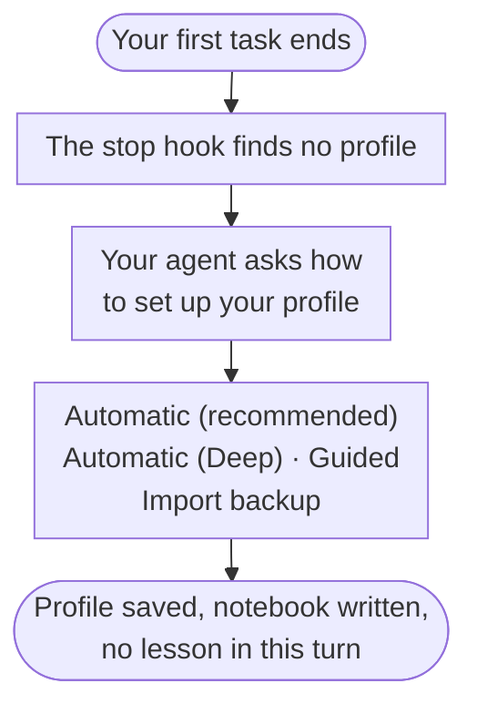
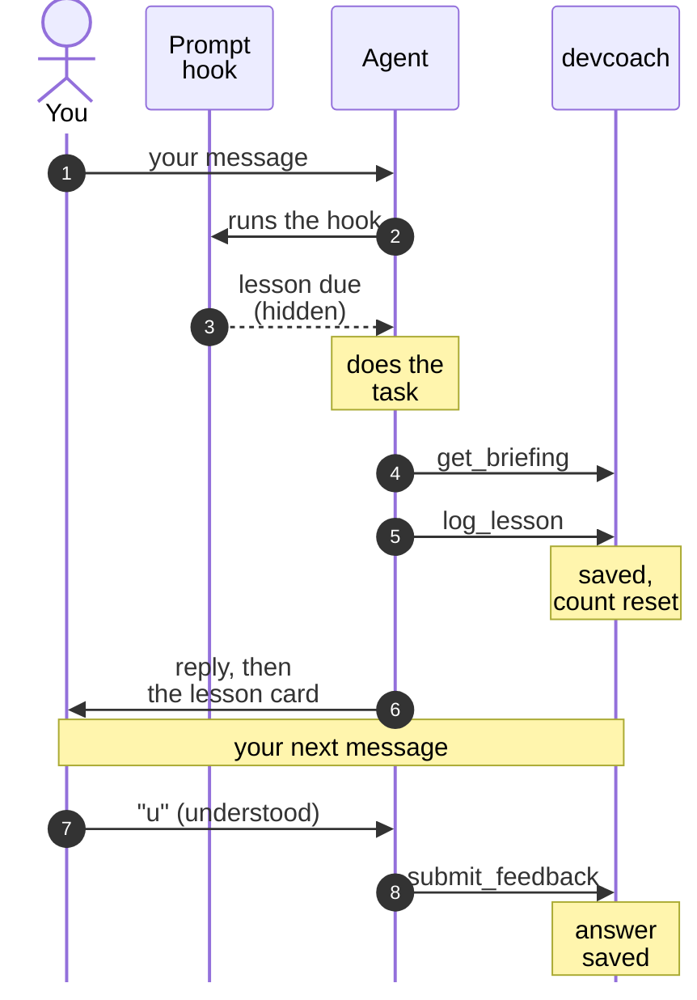
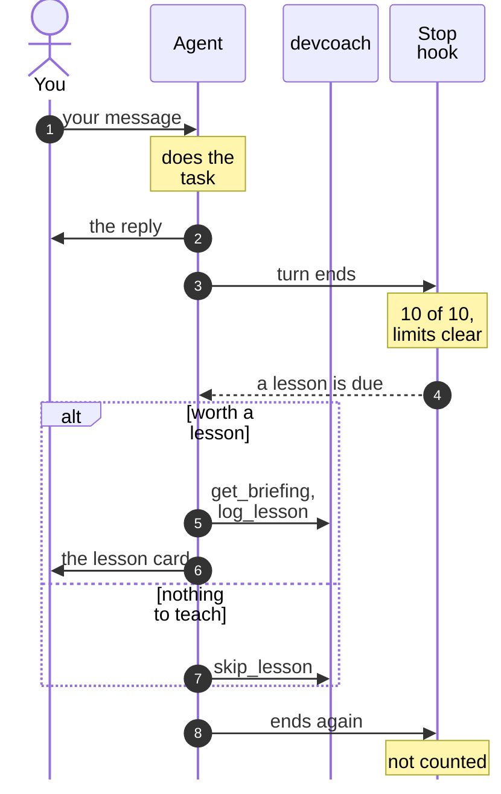
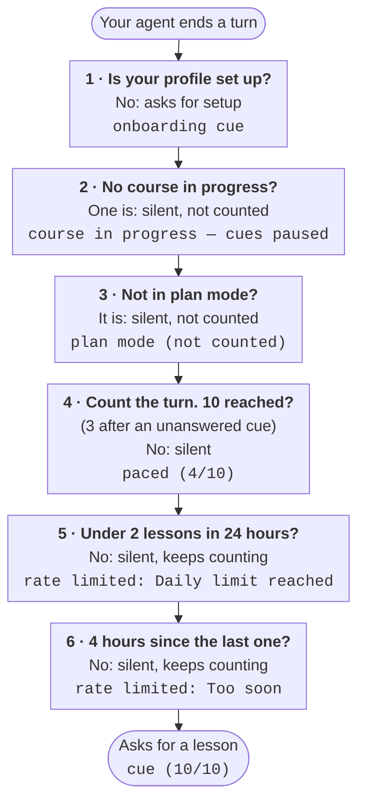

import Scale from "@site/src/components/Scale";

# How it works

devcoach runs next to your AI agent and stays quiet while you work. When your agent finishes a task
**and a lesson is due**, it ends its reply with one short lesson on something that task touched and
you don't know yet. Most turns, no lesson is due and you see nothing. The pace is yours to set: by
default, one cue about every 10 interactions in a chat session, at most 2 lessons a day, at least
4 hours apart.

What starts a lesson depends on your agent:

| Your agent | What starts a lesson | What paces it |
|---|---|---|
| Claude Code, Gemini CLI *(beta)*, Codex CLI *(beta)* | devcoach's hooks, when a task ends | A count of turns, a daily limit, a gap |
| Claude Desktop, Cursor, Windsurf, Cline, Continue, Zed | You ask for one | You |
| claude.ai web | Not supported: no local MCP server there | |

devcoach wires automatic lessons only into Claude Code (through the plugin or `devcoach install`),
Gemini CLI and Codex CLI. In Codex CLI the hooks run only after you trust them. The other agents get
every devcoach tool, but devcoach cannot prompt a lesson after a task there: say *"set up devcoach"*
once, then ask when you want a lesson (*"teach me something from what we just did"*). Every agent on
one computer shares the same profile and lessons (`~/.devcoach`). [Install](./install/index.md) lists
what each agent gets. The rest of this page follows an agent with hooks.

## Your first task

Nothing happens when a session starts. At the end of your first task, the stop hook finds no profile
and asks your agent to set one up.

Your agent asks you how, and recommends Automatic. The devcoach skill offers four ways:

| Way | What happens |
|---|---|
| **Automatic** | Asks nothing more. It builds your topics from the stack it finds in your 15 most recently active Claude Code projects (their dependency lists and file names), saves them, writes the coaching notebook and shows you the result, which you can change |
| **Automatic (Deep)** | The same, and it also reads conversation text from your recent local Claude Code sessions |
| **Guided** | A short conversation about the technologies you use and how confident you are in each |
| **Import backup** | Restores your profile from a devcoach backup |

Until a profile exists, the end of every task asks again. You can also start it yourself: say *"set
up devcoach"*, or run `/devcoach:setup` with the Claude Code plugin.
[Coaching in your agent](./usage/coaching.md#onboarding) shows each way in detail.

## One coached turn {/* #coaching-loop */}

Two hooks run around every turn: the **prompt hook** when you send a message, and the **stop hook**
when your agent finishes. The stop hook counts the turns. The prompt hook only looks.

### Usually: your agent knows before it starts

When your message arrives, the prompt hook checks, without counting, whether the end of this turn
will reach the threshold. If it will, it tells your agent, out of your sight, that a lesson is due:

Your agent loads the devcoach skill and reads what it needs in one `get_briefing` call: your
profile, the topics already taught, the coaching notebook. `log_lesson` only saves; the card you
read is your agent's own text, written once, at the end of its reply. The save also restarts the
count, so the stop hook counts this turn as 1 of the next 10. Your answer under the card is recorded
on the next turn ([what it changes](#your-answer)).

### Otherwise: the stop hook asks

If your agent was not told, or did not act on it, the stop hook asks when the turn ends:

The stop hook counts the turn, finds the threshold reached and the limits clear, and holds the turn
open with a request for a lesson. Your agent delivers one the same way or, with nothing worth
teaching (a question, a chat), declines with `skip_lesson`. Either answer restarts the count. If
your agent does neither, the cue stays open and comes back after 3 more turns instead of 10.

:::note[In Claude Code]

A stop hook that asks for more work shows the notice *"Stop hook error occurred"*. For a lesson it
comes with the line *"🎓 devcoach: checking whether a lesson is due…"*. Nothing is broken
([Troubleshooting](./troubleshooting.md)).

:::

## Why no lesson this time?

Most turns end without a lesson, on purpose. When a turn ends, the stop hook runs these checks in
this order and stops at the first one that fails:

- The numbers are the defaults of `nudge_every`, `max_per_day` and `min_gap_minutes`. Each one is a
  setting ([Configuration](./reference/configuration.md#settings)).
- A course in progress and plan mode skip the turn without counting it. (Gemini CLI has no plan
  mode.)
- A turn held back by a limit still counts, so the lesson comes at the first turn the limits allow.
- The count is per chat session, or across all sessions when `nudge_scope` is `global`.
- Only your own lessons use the limits. A lesson someone shared with you never does.

If lessons never come, see [Troubleshooting](./troubleshooting.md).

:::note[See each check happen]

The code in each box is how that check's line starts in `~/.devcoach/hook.log`, which every hook run
writes to when `DEVCOACH_HOOK_DEBUG=1` is set in your agent's environment. A full line reads, for
example, `rate limited: Too soon: last lesson 0m ago, minimum interval is 4h 0m (3h 59m remaining)`.
Two lines can also come before check 1: `hook-forced continuation`, for the extra turn that a
request from the stop hook starts (never counted), and one starting `error: SchemaTooNewError:` when
a newer devcoach has upgraded your database (the hooks then stay silent). `devcoach doctor` shows the profile, count and
limit checks for your next turn under **Verdict**.

:::

## How a lesson is chosen and pitched

### What it teaches {/* #lesson-selection */}

When a lesson is due, the coach looks at the task that just ended and takes the first match:

| | What the coach looks for |
|:---:|---|
| ① | **Notebook follow-up:** an angle your coaching notebook recommends, on a topic the task touched |
| ② | **Profile pitfall:** a pitfall you avoided or ran into in the task, on a topic in your profile |
| ③ | **Profile pattern:** a pattern in the task worth formalising, on a topic in your profile |
| ④ | **Off-profile pitfall or pattern:** the same, on a task topic that is not in your profile (the coach may offer to add that topic instead) |
| ⑤ | **Knowledge gap:** a profile topic related to the task, where your confidence is below 5 |
| ⑥ | **Deep-dive:** a profile topic at confidence 4 to 6 |

On a tie, a topic in your profile wins, and a lesson never strays from the task. A topic already
taught is never repeated, nor a close variant of it, unless your confidence in it is 10. Lessons
[shared with you](./usage/sharing.md) sit in the same log, marked with their sender's name, and count as taught. With
nothing worth teaching, there is no lesson (`skip_lesson`, when a hook asked for one).

### How deep it goes {/* #depth-calibration */}

Depth follows your confidence in the one topic being taught, never an average:

<Scale
  bands={[
    { from: 0, to: 3, label: "junior", tone: "low" },
    { from: 4, to: 6, label: "mid", tone: "mid" },
    { from: 7, to: 9, label: "senior", tone: "high" },
  ]}
  marks={[{ at: 10, label: "cutting-edge only, at any level" }]}
  caption="Your confidence in a topic, from 0 to 10, and the level of its lessons."
/>

| Confidence | Level and angle |
|:---:|---|
| 0–3 | **junior:** correct professional practice from scratch, with analogies and no jargon |
| 4–6 | **mid:** the why, the alternatives and the trade-offs |
| 7–9 | **senior:** edge cases, production trade-offs, architecture, historical context |
| 10 | **cutting-edge only:** something from the last ~6 months, at any level. It may return to a taught topic; the rate limit still applies |

Levels follow professional practice: even a junior lesson is about real failure modes. The coach
never pitches below your band and, when in doubt, aims higher.
Observations in the coaching notebook can shift the angle too.

#### What your answer changes {/* #your-answer */}

| Your answer | What changes |
|---|---|
| ✅ knew it (`y`) | Your confidence on the topic goes up one point, so its next lessons go deeper. In the agent, the coach records it only while the topic is rated below the lesson's level |
| 💡 understood (`u`) | Nothing: the level was right |
| ❌ couldn't follow (`n`) | Nothing for now. The lesson is kept as the seed of a step-by-step course, which the coach offers once |

Later, at a notebook checkpoint, the coach looks at your last ten answers and may move a topic one
point up or down, and may add a topic that keeps coming up. It also updates the coaching notebook
(`~/.devcoach/learning-state.md`), its own notes on how you learn, with a direct file write.

The priority list and the bands come from the devcoach skill (`SKILL.md` and its references), which
the MCP server also serves as the `devcoach_instructions` prompt.
