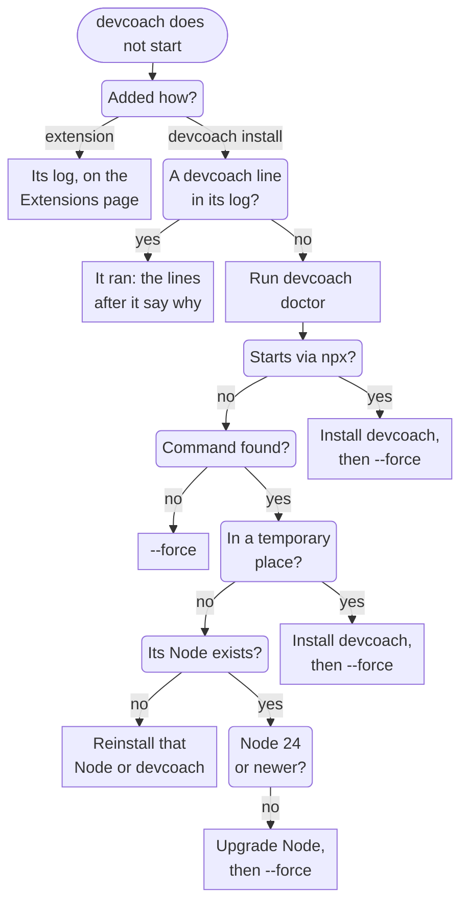

import { Card, Cards } from "@site/src/components/Cards";
import FileTree from "@site/src/components/FileTree";
import LogLine from "@site/src/components/LogLine";
import Terminal from "@site/src/components/Terminal";
import Tabs from "@theme/Tabs";
import TabItem from "@theme/TabItem";

export const installDesktop = "\u001b[1mSetting up devcoach\u001b[22m\u001b[2m  (~/.nvm/versions/node/v24.22.3/bin/devcoach mcp)\u001b[22m\n\u001b[33m  bound to Node v24.22.3 (nvm) — after removing or switching that version, run `devcoach install --force` again\u001b[39m\n\n\u001b[1mClaude Desktop\u001b[22m\n  MCP server…  \u001b[32m✓\u001b[39m Installed into ~/.config/Claude/claude_desktop_config.json\n\n\u001b[33m→\u001b[39m Restart Claude Desktop to pick up the new server.\n\n\u001b[2mTip: run devcoach backup to export your profile, lessons and settings.\n     run devcoach restore <file> to import a backup on a new machine.\n     After upgrading devcoach (npm, Homebrew), re-run devcoach install to refresh the skill.\u001b[22m";
export const doctorDesktop = "\n\u001b[1mdevcoach doctor\u001b[22m \u001b[2mv2.7.1\u001b[22m\n\n…\n\u001b[1m\nClaude Desktop\u001b[22m\n  \u001b[32m✓\u001b[39m registered: ~/.nvm/versions/node/v24.22.3/bin/devcoach mcp\n  \u001b[32m✓\u001b[39m command resolves to ~/.nvm/versions/node/v24.22.3/bin/devcoach\n  \u001b[33m→\u001b[39m bound to Node v24.22.3 (nvm) — removing or switching that version breaks it with `Failed to spawn process: No such file or directory`; run `devcoach install --force` after\n  \u001b[32m✓\u001b[39m runs on Node 24.22.3 (~/.nvm/versions/node/v24.22.3/bin/node)\n  \u001b[32m✓\u001b[39m it runs devcoach 2.7.1\n\n…";
export const doctorFixture = "\n\u001b[1mdevcoach doctor\u001b[22m \u001b[2mv2.7.1\u001b[22m\n\n…\n\u001b[1m\nClaude Desktop\u001b[22m\n  \u001b[32m✓\u001b[39m registered: devcoach mcp\n  \u001b[31m✗\u001b[39m `devcoach` is not found on Claude Desktop's PATH (from its log) — the host fails with `Failed to spawn process: No such file or directory`. Reinstall devcoach, then run `devcoach install --force`\n    log: ~/.config/Claude/logs/mcp-server-devcoach.log\n    last error in it: Failed to spawn process: No such file or directory\n\n…";

# Claude Desktop

There are two ways to add devcoach to Claude Desktop. The **extension** *(beta)* is one file you
install from Claude Desktop, with no terminal and no Node.js to set up. **`devcoach install`** writes
an entry in Claude Desktop's config when you have the `devcoach` command (Homebrew, npm, Windows).
Use one of the two.

## What you get here

<Cards columns={3}>
  <Card label="Yes" title="All 25 tools">
    Claude can build your profile, save and find lessons, share them and run courses.
  </Card>
  <Card label="When you ask" title="Lessons">
    devcoach has no hooks in Claude Desktop, so no lesson comes on its own after a task.
  </Card>
  <Card label="A prompt only" title="The devcoach skill">
    Not installed here. Its rules reach Claude through the **devcoach_instructions** prompt, if you add it.
  </Card>
</Cards>

Say *set up devcoach* once, then ask when you want a lesson: *teach me something from what we just
did*. devcoach wires automatic lessons only into Claude Code, Gemini CLI and Codex CLI. Every agent on
this computer shares your profile and lessons (`~/.devcoach/`). Other agents:
[what each agent gets](./index.md#what-each-agent-gets).

## You need

- **Claude Desktop on macOS or Windows**, signed in.
- **For the extension, nothing else.** It runs on the Node.js built into Claude Desktop. devcoach
  needs Node.js 24 or newer and the extension declares it; Anthropic does not publish the app's
  version ([if it is too old](#installed-as-the-extension)).
- **For `devcoach install`:** devcoach from [Homebrew](./homebrew.md), [npm](./npx.md) or the
  [Windows installer](./windows.md). Homebrew and the Windows installer bring their own Node.js; npm
  needs Node.js 24 or newer.

## Install

<Cards columns={2}>
  <Card label="No terminal · beta" title="The extension">
    Installed from Claude Desktop, on its own Node.js. No `devcoach` command. To update, install the new file.
  </Card>
  <Card label="In a terminal" title="devcoach install">
    With devcoach from Homebrew, npm or Windows. Adds the `devcoach` command. To update, update devcoach.
  </Card>
</Cards>

:::warning[Pick one]

With both, Claude Desktop has devcoach twice.

- **Ran `devcoach install` already** (Homebrew, npm, the Windows installer)? Claude Desktop has
  devcoach: skip the extension, or [remove that entry](#remove) first.
- **Have the extension, and want the command for Claude Code?** A bare `devcoach install` also adds
  a Claude Desktop entry. Name Claude Code alone:

  ```bash
  devcoach install --claude-code
  ```

:::

<Tabs groupId="desktop-route">
<TabItem value="extension" label="The extension" default>

1. Download `devcoach-<version>.mcpb` from the
   [latest release](https://github.com/UltimaPhoenix/dev-coach/releases/latest).
2. **Double-click the file**, or drag it onto the Claude Desktop window. From the menus instead: open
   **Settings → Desktop app** and click **Manage** next to **Extensions** (older layout: **Settings →
   Extensions**), then **Advanced settings**, and under **Extension Developer** click **Install
   Extension…** and pick the file.
3. Review the details and install. **Unverified publisher** is expected: the file is self-signed,
   as no code-signing certificate is configured.

Menu names as in
[Anthropic's guide](https://support.claude.com/en/articles/10949351-getting-started-with-local-mcp-servers-on-claude-desktop);
if they move, look for **Extensions** in the settings. No Extensions there? Your organization has
turned extensions off.

<details>
<summary>Check the download</summary>

Every release publishes `SHASUMS256.txt` next to the `.mcpb`. Save it in the same folder, then on
macOS:

```bash
shasum -a 256 -c SHASUMS256.txt --ignore-missing
```

It prints `devcoach-2.7.1.mcpb: OK` (with your version). In Windows PowerShell, print the file's hash
and compare it with its line in `SHASUMS256.txt` (PowerShell prints it in capitals):

```powershell
(Get-FileHash .\devcoach-2.7.1.mcpb -Algorithm SHA256).Hash
```

</details>

<details>
<summary>Build the file from source</summary>

For contributors. You need Node.js 24 with npm, and the network: the build fetches Anthropic's
`mcpb` packer with npx.

```bash
git clone https://github.com/UltimaPhoenix/dev-coach.git
cd dev-coach
npm install
npm run mcpb        # → dist-mcpb/devcoach-<version>.mcpb
npm run mcpb:sign   # the same, self-signed: it installs with the "unverified publisher" label
```

Install the result as in step 2.

</details>

</TabItem>
<TabItem value="install-command" label="devcoach install">

You have most likely run it already: a bare `devcoach install` sets up Claude Code **and** Claude
Desktop. For Claude Desktop alone:

```bash
devcoach install --claude-desktop
```

Then restart Claude Desktop: it reads its list of servers when it starts.

</TabItem>
</Tabs>

## What it set up

<FileTree
  root="~/  (macOS)"
  items={[
    { name: "Library/Application Support/Claude/", children: [
      { name: "Claude Extensions/", note: "the extension, unpacked here by Claude Desktop" },
      { name: "claude_desktop_config.json", note: <>the entry from <code>devcoach install</code>: the full path of your devcoach, then <code>mcp</code></> },
    ] },
    { name: "Library/Logs/Claude/", children: [
      { name: "mcp-server-devcoach.log", note: "Claude Desktop's log for that entry, with devcoach's own line" },
    ] },
    { name: ".devcoach/", note: "your lessons, profile, notebook and courses, created the first time Claude uses devcoach. Shared with every agent" },
  ]}
  caption={<>On Windows the first two are under <code>%APPDATA%\Claude\</code>, the log in <code>%APPDATA%\Claude\logs\</code>, your data in <code>%USERPROFILE%\.devcoach\</code>.</>}
/>

`devcoach install` writes an absolute command, so Claude Desktop does not have to find devcoach on
its own PATH (on Windows: `node.exe` and devcoach's script), and says what it wrote:

<Terminal
  command="devcoach install --claude-desktop"
  output={installDesktop}
  caption="devcoach 2.7.1 installed with npm under nvm, captured on Linux in a test home (there the config is in ~/.config/Claude/). The yellow line: see the version-manager note at the end of this page."
/>

## Check it worked

In Claude Desktop, click **+** at the bottom of the chat box, then **Connectors**: devcoach and its
tools are listed. The Extensions page's **Local MCP servers** section shows its status and log (older
layout: **Settings → Developer**).

With `devcoach install`, run `devcoach doctor` and read its **Claude Desktop** section:

<Terminal
  command="devcoach doctor"
  output={doctorDesktop}
  caption="Right after the install above, the other sections cut (…). Claude Desktop starts this exact command."
/>

What matters: **command resolves to** your devcoach, **runs on Node** 24 or newer, **it runs
devcoach** at your version. Not using Claude Code? Ignore doctor's ✗ lines about it.

### devcoach's line in the log

Each time it starts, devcoach writes this line to Claude Desktop's log. If it is there, devcoach ran:

<LogLine
  parts={[
    { text: "devcoach 2.7.1 mcp", label: "Version", note: <>which devcoach ran; <code>mcp</code> is the server.</> },
    { text: "node 24.22.3 via nvm (~/.nvm/versions/node/v24.22.3/bin/node)", label: "Node.js", note: "the version it runs on, and what provides it: Homebrew, nvm, fnm, volta, asdf, mise, n or the system." },
    { text: "npm-global, bound to Node v24.22.3 (nvm) (~/.nvm/versions/node/v24.22.3/lib/node_modules/devcoach)", label: "Install channel", note: <>how devcoach was installed (<code>homebrew</code>, <code>npm-global</code>, <code>npx</code>; the extension is <code>claude-desktop-extension</code>) and what it depends on, here one Node version.</> },
    { text: "data ~/.devcoach (schema 6)", label: "Data", note: <>your data folder and its database version. <code>(no database yet)</code> on the first start is normal.</> },
  ]}
  caption={<>A real start of devcoach 2.7.1, captured on Linux in a test home. devcoach writes your home folder as <code>~</code> (<code>%USERPROFILE%</code> on Windows); Claude Desktop's own lines in the log may still show it.</>}
/>

Once Claude Desktop connects, a second line names the client: `devcoach 2.7.1 mcp · client …`.

## First run

Open a new conversation and say *set up devcoach*. Claude asks how to build your profile and
recommends Automatic: it starts from your Claude Code projects if you have some, else from devcoach's
general topic map.

Then ask for a lesson when you want one: *teach me something from what we just did*. Claude Desktop
adds no MCP prompt to a conversation by itself; add **devcoach_instructions** for devcoach's full
coaching rules.

Web dashboard: ask *open the devcoach dashboard*, or run `devcoach ui` if you have the command. From the extension, asking is
untested on Claude Desktop's built-in Node; `npx -y devcoach ui` works with Node.js 24.

## Update

**The extension:** install the new `.mcpb` the same way. By default Claude Desktop updates extensions
from its directory on its own, not one installed from a file.

**`devcoach install`:** update devcoach as you installed it (Homebrew, npm, Windows), then restart
Claude Desktop. The entry keeps its path. Only after switching Node versions under nvm or a similar
manager:

```bash
devcoach install --claude-desktop --force
```

## Remove

**The extension:** remove devcoach on the Extensions page (as in [Install](#install)).

**`devcoach install`:** remove the entry, then restart Claude Desktop:

```bash
devcoach uninstall --claude-desktop
```

It leaves Claude Code alone (a bare `devcoach uninstall` removes both). Then remove devcoach itself:
[Homebrew](./homebrew.md), [npm](./npx.md), [Windows](./windows.md).

**Your data** stays in `~/.devcoach/`, which every agent on this computer uses. To delete it, back up
first if you might come back (`devcoach backup`, or **Download backup** in the dashboard's Settings),
then run this; it asks first:

```bash
devcoach uninstall --claude-desktop --data
```

With only the extension, put `npx -y` in front (needs Node.js 24), or delete the `.devcoach` folder
in your home folder.

## If it doesn't work {/* #when-devcoach-does-not-start */}

Start from how devcoach got into Claude Desktop:



**--force** is `devcoach install --claude-desktop --force`. Below doctor are its own checks, in its
order; its ✗ line says which one failed.

### Installed as the extension

| What you see | What to do |
|---|---|
| No **Extensions** in Settings | Your organization has turned extensions off |
| Claude Desktop refuses the file, or asks for a newer Node.js | Update Claude Desktop, or use `devcoach install` instead |
| devcoach stops at once; its log says `needs Node 24 or newer` | The same |
| Installed, but no devcoach tools | Restart Claude Desktop, then look in **+** → **Connectors** |

The extension declares Node.js 24 or newer, for devcoach's built-in database. Started on Node 22, the
released 2.7.1 extension logged one line: `devcoach 2.7.1 needs Node 24 or newer (it uses the
built-in node:sqlite); this is Node 22.22.0 at /opt/node22/bin/node. Upgrade Node, then restart.`

`npx -y devcoach doctor` (Node.js 24) checks your database, but its Claude Desktop section reads only
`claude_desktop_config.json` and says `not registered — add it with devcoach install
--claude-desktop`. Ignore it: **don't run `devcoach install` next to the extension**, or Claude
Desktop gets devcoach twice.

### Added by `devcoach install`

**Read the log first.** Claude Desktop keeps one log per MCP server:

| OS | Log |
|---|---|
| macOS | `~/Library/Logs/Claude/mcp-server-devcoach.log` |
| Windows | `%APPDATA%\Claude\logs\mcp-server-devcoach.log` |

**`Failed to spawn process: No such file or directory`** with no devcoach line after it means
devcoach never ran. Run **`devcoach doctor`**: it looks the command up on the PATH from Claude
Desktop's log and checks the Node behind it. Here, on a real log of a failed start and the bare
`devcoach` entry that `devcoach install` wrote before 2.7.0:

<Terminal
  command="devcoach doctor"
  output={doctorFixture}
  caption="The log is the real one kept in devcoach's tests (tests/fixtures/claude-desktop-mcp-devcoach.log); captured on Linux, where the log is in ~/.config/Claude/logs/. Other sections cut (…)."
/>

It tells apart the two reasons the system could not run the command in Claude Desktop's config:

- the command is not there: devcoach was uninstalled, or a bare `devcoach` is not on the PATH
  *Claude Desktop* uses (it prints that PATH in the log, next to `Using MCP server command`);
- the command is there, but the Node it names in its first line is not, for example Homebrew's Node
  was removed while Homebrew's devcoach still points at it.

Then write an absolute command and restart Claude Desktop:

```bash
devcoach install --claude-desktop --force
```

It rewrites only the Claude Desktop entry; doctor's own hint, `devcoach install --force`, also sets
up Claude Code. While reading the log, ignore `Server started and connected successfully`: Claude
Desktop writes it before the process starts, so it also appears right before a failure.

:::note[nvm, fnm, volta, asdf, mise]

`npm i -g` under a Node version manager puts devcoach inside one Node version's folder
(`~/.nvm/versions/node/v24.22.3/…`). Remove or switch that version and Claude Desktop fails as above.
`devcoach install` and `devcoach doctor` name the version. More on the [npx / npm page](./npx.md).
After changing Node:

```bash
devcoach install --claude-desktop --force
```

:::

Anything else: [Troubleshooting](../troubleshooting.md).

<Cards>
  <Card label="Next" title="Coaching in your agent" to="/usage/coaching">
    What a lesson looks like and what your answers do. In Claude Desktop, each lesson starts when you ask.
  </Card>
</Cards>
