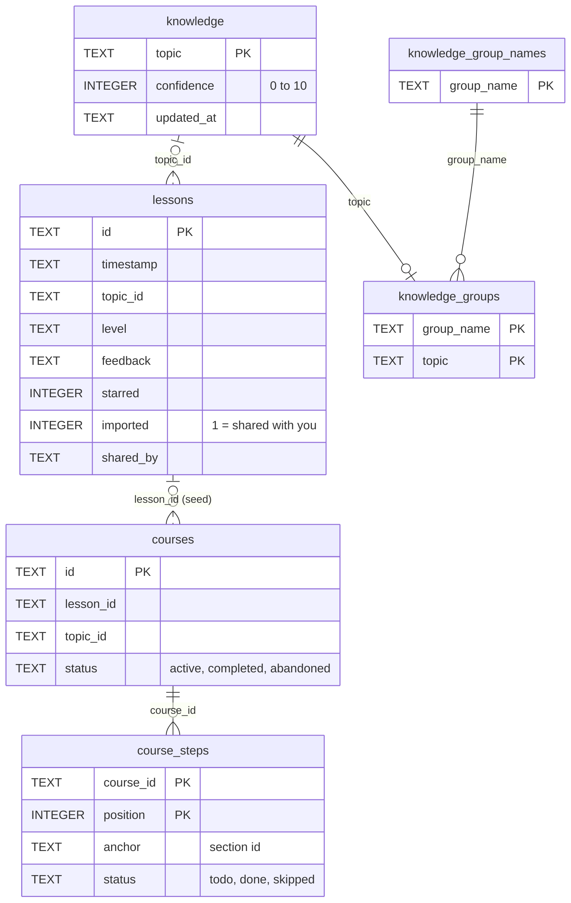

# Configuration

import { Cards, Card } from "@site/src/components/Cards";
import FileTree from "@site/src/components/FileTree";
import RefTable from "@site/src/components/RefTable";
import Terminal from "@site/src/components/Terminal";
import WideDiagram from "@site/src/components/WideDiagram";
import cli from "@site/src/data/cli-output.json";

export const doctorPacing = (() => {
  const lines = cli.doctor.split("\n");
  const at = lines.findIndex((line) => line.startsWith("Database & pacing"));
  return at > 3 ? [...lines.slice(0, 3), "…", ...lines.slice(at - 1)].join("\n") : cli.doctor;
})();

Every setting devcoach has, the rules that decide when a lesson comes, and everything devcoach keeps on
your computer.

<Cards columns={2}>
  <Card title="Settings and pacing" label="Part 1" to="#settings-and-pacing">
    The seven settings and where to change them, the exact pacing rules, and the environment variables.
  </Card>
  <Card title="Your data" label="Part 2" to="#your-data">
    What is in `~/.devcoach`, what a backup holds and what a restore does, how to reset, and the database.
  </Card>
</Cards>

## Settings and pacing {/* #settings-and-pacing */}

The pace is yours to set. The numbers below are the defaults.

### The seven settings {/* #settings */}

They live in the `settings` table of the database and travel in every backup.

<RefTable>

| Setting | What it does | Default |
|---|---|---|
| `max_per_day` | The most lessons in any 24 hours.<br/>Allowed: 1 to 20. | default 2 |
| `min_gap_minutes` | The least time between two lessons, in minutes. `0` means no gap.<br/>Allowed: 0 to 1440. | default 240 (4 h) |
| `nudge_every` | How many interactions (replies of your agent) come between two lesson cues. `0` means a cue on every reply, within the two limits above.<br/>Allowed: 0 to 1000. | default 10 |
| `nudge_scope` | Count interactions per chat session, or all your sessions together.<br/>Allowed: `session`, `global`. | default session |
| `share_name` | The name put on lessons you share. Empty: your git `user.name`, else anonymous. Sharing with `devcoach share --by <name>` while it is empty also sets it.<br/>Allowed: up to 80 characters. | default empty |
| `ui_theme` | The dashboard's colours. `system` follows your OS. Dashboard only.<br/>Allowed: `system`, `light`, `dark`. | default system |
| `ui_home` | Where the dashboard opens. `auto`: Lessons once you have one, the knowledge map before. Dashboard only.<br/>Allowed: `auto`, `lessons`, `knowledge`. | default auto |

</RefTable>

### Where to change them

<Cards columns={3}>
  <Card title="Ask your agent" label="Agent">
    Say *set my max lessons per day to 3*. Its `update_settings` tool checks the range. The first five
    settings.
  </Card>
  <Card title="In a terminal" label="CLI">
    `devcoach set max_per_day 3`, and `devcoach settings` to list them. The first five settings.
  </Card>
  <Card title="On the dashboard" label="Web">
    The Settings page of `devcoach ui`. All seven; the gap is a list of 12 presets, from none to 24 hours.
  </Card>
</Cards>

Your agent sends one key and its value as a string: `{ "key": "max_per_day", "value": "3" }`.
`devcoach ui` starts the dashboard on port 7860 of `127.0.0.1` only, so other machines cannot reach
it: <code style={{ whiteSpace: "nowrap" }}>{"--port <n>"}</code> picks another port,
<code style={{ whiteSpace: "nowrap" }}>--open</code> opens your browser,
<code style={{ whiteSpace: "nowrap" }}>--stop</code> stops the dashboard running on that port. More on the [web dashboard](../usage/web-ui.md) page.

:::warning[Three things to know before you change a setting]

- **`0` is not "off".** `devcoach settings` shows `nudge_every` 0 as `0 (off)`, and an error message
  of `devcoach set` says `0 = off`. Both are wrong: 0 cues a lesson on every reply. For fewer lessons,
  raise `nudge_every` or lower `max_per_day`. The quietest setting is 1000 for `nudge_every` with 1
  for `max_per_day`.
- **`devcoach set` does not check ranges.** It checks only that `nudge_every` starts with a whole
  number of 0 or more (`1.5` and `12abc` pass), that `nudge_scope` is `session` or `global`, and that
  `share_name` is at most 80 characters. Anything else is stored as typed, and a value outside its
  range, or a word, can stop lessons or remove a limit. Your agent's tool and the dashboard do check.
- **The dashboard's gap is a list of presets.** With another value set elsewhere (say 100 minutes), the
  list shows *No cooldown*, and saving the form stores 0. Pick the gap again before you save.

:::

### How pacing works {/* #rate-limits */}

devcoach wires automatic lessons only into Claude Code, Gemini CLI (beta) and Codex CLI (beta). Their
hooks run each time the agent finishes a reply. In Claude Desktop and other MCP agents nothing is
counted: you ask for a lesson. Short sessions may end with no lesson at all; that is by design.

**Each reply your agent finishes is one interaction.** It adds one to the counter of its chat session
(with `nudge_scope` set to `global`, the counters of all sessions add up). These replies do not count:

<RefTable>

| Reply | Why it is not counted |
|---|---|
| **in plan mode** (Claude Code and Codex CLI) | Planning is not coachable work. |
| **the one your agent writes because devcoach asked for it** | It is the turn that answers devcoach's own cue. |
| **any reply before onboarding** | The hook offers onboarding instead. |
| **any reply while a course is in progress** | Cues pause, so nothing interrupts the course, until you complete or abandon it. |
| **any reply while this devcoach can only read the database** | It cannot save anything ([two versions](#two-versions)). |

</RefTable>

**A cue comes** when the counter reaches `nudge_every` and the rate limit allows a lesson: fewer than
`max_per_day` of your own lessons in the last 24 hours (a rolling window, not a calendar day), and at
least `min_gap_minutes` since your last one. A reply that reaches the threshold while the limit says no
still counts, so the cue comes with the first reply the limit allows. With `nudge_every` at 0 there is
no counter: every reply that counts gets a cue, within the rate limit.

**A cue, a lesson and a skip each restart every counter**, in every session. What comes next:

<RefTable>

| After | The next cue needs |
|---|---|
| **a cue your agent has not answered yet** | `min(3, nudge_every)` replies in one session (in total with `global`) |
| **a lesson** (`log_lesson`) | `nudge_every` replies |
| **a skip** (`skip_lesson`), when the work was not technical | `nudge_every` replies |
| **a lesson someone [shared with you](../usage/sharing.md)** | Nothing changes: it never counts toward `max_per_day`, never starts the gap and never restarts a counter. |

</RefTable>

**A lesson you ask for** ("teach me something") comes even when the rate limit says no: the devcoach
skill tells your agent to go ahead. It then counts like any other lesson. How a cue turns into a lesson
card is on [How it works](../how-it-works.md).

#### Where to see the current state

<Terminal
  command="devcoach doctor"
  output={doctorPacing}
  caption={
    <>
      Its last two blocks; the three before them (your Node, and how Claude Code and Claude Desktop
      start devcoach) are cut here. <em>Database &amp; pacing</em> shows your settings, how many replies
      have been counted and the rate limit. <em>Verdict</em> says whether the next reply would get a
      cue, and why. The verdict does not look at courses yet: while a course is in progress, no cue
      comes, whatever it says.
    </>
  }
/>

For a live trace, set `DEVCOACH_HOOK_DEBUG=1` in the environment your agent starts from: each hook run
adds one line to `~/.devcoach/hook.log` with its decision, such as `paced (3/10)` or `rate limited: …`.

#### Examples

```bash
# Fewer: one lesson in any 24 hours,
# and a cue only after 20 replies
devcoach set max_per_day 1
devcoach set nudge_every 20

# More: a cue every 5 replies,
# up to 5 lessons in 24 hours, an hour apart
devcoach set nudge_every 5
devcoach set max_per_day 5
devcoach set min_gap_minutes 60

# The most the ranges allow: a cue on
# every reply, 20 lessons in 24 hours, no gap
devcoach set nudge_every 0
devcoach set max_per_day 20
devcoach set min_gap_minutes 0

# Back to the defaults
devcoach set max_per_day 2
devcoach set min_gap_minutes 240
devcoach set nudge_every 10
```

### Environment variables {/* #environment-variables */}

Every variable devcoach reads, and who it is for. Five more, used only by tests and by the plugin's and
the extension's launcher, are folded under the table.

<RefTable>

| Variable | What it does | For |
|---|---|---|
| `DEVCOACH_HOOK_DEBUG=1` | Each hook run adds one line with its decision to `hook.log` in the data folder. The file is emptied once it passes 256 KB. | *you* |
| `NO_COLOR` | No colours in CLI output, and no clickable links unless `FORCE_HYPERLINK` is set. | *you* |
| `FORCE_COLOR` | Colours even when the output goes to a pipe or a file. `0` or `false` turn colours off. `NO_COLOR` wins over it. | *you* |
| `FORCE_HYPERLINK=1` | Clickable links on a terminal devcoach does not recognise, even with `NO_COLOR` or a pipe. | *you* |
| `COLUMNS` | When the output is not a terminal: the width of the `── title ──` lines in `devcoach lesson`, `course` and `setup` (otherwise 80, at most 100). Tables always fit their content. | *you* |
| `DEVCOACH_DIR` | Moves the data folder (database, notebook, courses, `hook.log`) away from `~/.devcoach`. `DEVCOACH_DIR=$(mktemp -d) devcoach stats` leaves your real data untouched. | tests, sandboxes |
| `CLAUDE_CONFIG_DIR` | Claude Code's own variable. When it is set, the onboarding scan reads Claude Code's history inside this folder (`~/.claude` and `~/.claude.json` by default). `devcoach install` writes its hooks and skill to `~/.claude` either way. | Claude Code |
| `HOME` | Where `~` is: the data folder and every agent config devcoach reads or writes (`USERPROFILE` on Windows). `HOME=$(mktemp -d) devcoach …` is a full sandbox. | your system |
| `XDG_CONFIG_HOME` | On Linux, where `install`, `uninstall` and `doctor` look for Claude Desktop's config, and `doctor` for its log. `APPDATA` does the same on Windows. | your system |
| `PATH` | How `install` finds the `devcoach` and `node` commands it writes into your agents' config, and how `doctor` checks them (with `PATHEXT` on Windows). | your system |
| `TERM`, `TERM_PROGRAM` | With a few similar variables: whether to use colours (`TERM=dumb` turns them off) and clickable links. | your terminal |

</RefTable>

<details>
<summary>For tests and launchers: five more variables</summary>

<RefTable>

| Variable | What it does | For |
|---|---|---|
| `DEVCOACH_CLAUDE_DIR` | Where the onboarding scan reads Claude Code's history: `~/.claude` and `~/.claude.json` by default, both inside this folder when it is set. Wins over `CLAUDE_CONFIG_DIR`. | tests |
| `DEVCOACH_RUNTIME_DIR` | For the Claude Code plugin and the Gemini CLI extension: where their launcher installs its copy of devcoach. | tests |
| `DEVCOACH_RUNTIME_SPEC` | For the same launcher: which package it installs (by default the version they pin). | tests |
| `CLAUDE_PLUGIN_DATA` | Set by Claude Code for the plugin: its launcher installs devcoach in this folder. | Claude Code |
| `DEVCOACH_LAUNCHER` | Set by the plugin's or the extension's launcher; `doctor` prints it as the runtime in use. | the launcher |

</RefTable>

</details>

## Your data {/* #your-data */}

### Where it lives {/* #data-location */}

Your coaching data lives in `~/.devcoach/`: a SQLite database (`coaching.db`), the coaching notebook
(`learning-state.md`) and your course files (`courses/`).

<FileTree
  root="~/.devcoach/"
  items={[
    {
      name: "coaching.db",
      note: "the database: lessons, knowledge map, settings, the course index and the pacing counters. Created the first time devcoach needs it.",
    },
    {
      name: "learning-state.md",
      note: "the coaching notebook. Your agent writes it at onboarding and updates it at notebook checkpoints. The dashboard's Settings page shows it, read-only; to change it, edit this file.",
    },
    {
      name: "courses/",
      note: "one folder per course",
      children: [{ name: "<id>/index.html", note: "the course document your agent wrote" }],
    },
    {
      name: "hook.log",
      note: (
        <>
          only while <code>DEVCOACH_HOOK_DEBUG=1</code> is set; emptied once it passes 256 KB
        </>
      ),
    },
    {
      name: "gemini-ext/",
      note: "Gemini CLI extension only: the copy of devcoach it installs and runs. Not in backups.",
    },
  ]}
/>

devcoach has no account, no telemetry and no update check. It makes one kind of network request, and
only when you ask: importing a lesson from a web address downloads that page. Your data leaves the
machine only when you share a lesson or publish a course; as with anything in a session, what your agent
reads from devcoach becomes part of its conversation with its model. Every guarantee, with its limits,
is on [Privacy & security](privacy.md).

### Back up and restore {/* #backup-strategy */}

A backup is one zip with your settings, knowledge map, lessons, the notebook and your courses. It is not
encrypted, and it holds local folder paths (the folder each lesson was recorded in): keep it where you
would keep the data itself.

<Terminal command="devcoach backup devcoach-backup.zip" output={cli.backup} />

Without a file name, `devcoach backup` writes `devcoach-backup.zip` in the current folder. The count
covers lessons and topics; the zip holds the notebook and courses too. The dashboard's Settings page has
the same backup (*Download backup*) and restore (*Restore backup*).

```bash
# Every day, from a script or a scheduled task
# (in a crontab line, write each % as \%)
devcoach backup ~/Backups/devcoach-$(date +%Y%m%d).zip

# Before a big change
devcoach backup devcoach-before-reset.zip
```

A restore never removes a lesson, a topic or a course. It adds what you are missing; for your settings,
the notebook and the topics you both have, the backup wins:

<RefTable wideName>

| In the zip | What restore does with it | Effect |
|---|---|---|
| `settings.json`<br/>the seven settings | Replaces yours with the backup's. A backup without a `share_name` leaves yours. | **replaces** |
| `knowledge.json`<br/>topics, confidence, groups | Adds topics and groups. A topic you already have takes the backup's confidence, and its group when the backup gives one. Topics you added since stay. | merges |
| `lessons.json`<br/>every lesson, shared ones too | Adds each lesson whose id you do not have, so a deleted lesson comes back. A lesson you have stays as it is, with its star and your answer. | *adds* |
| `learning-state.md`<br/>the notebook, when there is one | Replaces your notebook with the backup's. | **replaces** |
| `courses.json`<br/>`courses/<id>/index.html`<br/>each course, its steps and document | Adds the courses you do not have, with their documents. A course you have, and its document, stay as they are. | *adds* |

</RefTable>

The pacing counters and `hook.log` are never in a backup.

<Terminal command="devcoach restore ~/Downloads/devcoach-backup.zip" output={cli.restore} />

Courses are restored too; the command prints no line for them. The same restore runs from the
dashboard, from the first step of `devcoach setup`, and when you pick *Import backup* at onboarding.

### Reset {/* #reset */}

**Rebuild your map, keep your lessons.** Your agent asks how you want to set up, replaces every topic
and group, and rewrites the notebook, keeping its earlier notes. Lessons, courses and settings stay.

```bash
devcoach backup before-reset.zip
# then ask your agent: redo onboarding
```

In a terminal, `devcoach setup` also replaces every topic and group, with two differences. It asks
again for the lessons per day and the gap, offering 2 and 240 (not your current values), so pressing
Enter resets them. And it leaves the notebook as it was.

**Start from nothing.** Deleting the folder removes the database, the notebook and the courses; on your
next task, devcoach offers onboarding again (in an agent with hooks; elsewhere say *set up devcoach*).

```bash
devcoach backup before-reset.zip   # optional
rm -r ~/.devcoach
```

Deleting only `coaching.db` would leave the notebook and the courses behind. With the Gemini CLI
extension, the folder also holds the extension's copy of devcoach, which the extension installs again.
Removing devcoach as well? `devcoach uninstall --data` takes it out of your agents and deletes
`~/.devcoach` after asking.

### Two devcoach versions, one database {/* #two-versions */}

Two installs on one computer (the plugin and Homebrew, say) share one database. When the newer one
upgrades it, the older one opens it read-only and never changes it:

<RefTable>

| Where | What happens with the older devcoach |
|---|---|
| CLI | Reads work; `stats`, `profile` and `lessons` end with a yellow note. A write is refused with a message that names both versions, and the command exits with status 3. |
| Dashboard | A banner says so. Pages that read keep working; a save is refused. |
| Your agent | devcoach's tools read as usual and refuse to save, saying why. No reply is counted and no lesson is cued. |
| `devcoach doctor` | Shows it in red under *Database & pacing*. |

</RefTable>

To fix it, update the older install (`brew upgrade devcoach`, `npm install -g devcoach@latest`, or
update the plugin), or use only the newer one.

### The database {/* #database-schema-reference */}

Seven tables hold your data. Six are drawn below; the seventh, `settings`, holds one row per setting
(`key`, `value`). The links between tables are by value: SQLite does not enforce them.

<WideDiagram label="Six tables of the database and how they relate">



</WideDiagram>

`lessons` has 19 columns; the diagram shows the ones you would ask about. Three more tables hold runtime
state and are never backed up: `nudge_state` (the reply counter of each of the 50 most recent sessions),
`cue_state` (whether a cue is waiting for an answer, and the last skip reason) and `schema_migrations`
(one-off data fixes already applied).

<details>
<summary>The full schema (SQL)</summary>

```sql
CREATE TABLE IF NOT EXISTS lessons (
    id                  TEXT PRIMARY KEY,
    timestamp           TEXT NOT NULL,
    topic_id            TEXT NOT NULL,
    categories          TEXT NOT NULL,
    title               TEXT NOT NULL,
    level               TEXT NOT NULL,
    summary             TEXT NOT NULL,
    body                TEXT,
    task_context        TEXT,
    project             TEXT,
    repository          TEXT,
    branch              TEXT,
    commit_hash         TEXT,
    folder              TEXT,
    feedback            TEXT,
    repository_platform TEXT,
    starred             INTEGER NOT NULL DEFAULT 0,
    imported            INTEGER NOT NULL DEFAULT 0,
    shared_by           TEXT
);

CREATE TABLE IF NOT EXISTS knowledge (
    topic       TEXT PRIMARY KEY,
    confidence  INTEGER NOT NULL DEFAULT 5,
    updated_at  TEXT NOT NULL
);

CREATE TABLE IF NOT EXISTS settings (
    key   TEXT PRIMARY KEY,
    value TEXT NOT NULL
);

CREATE TABLE IF NOT EXISTS knowledge_group_names (
    group_name TEXT PRIMARY KEY
);

CREATE TABLE IF NOT EXISTS knowledge_groups (
    group_name TEXT NOT NULL,
    topic      TEXT NOT NULL,
    PRIMARY KEY (group_name, topic)
);

CREATE TABLE IF NOT EXISTS courses (
    id            TEXT PRIMARY KEY,
    lesson_id     TEXT,
    topic_id      TEXT NOT NULL,
    title         TEXT NOT NULL,
    goal          TEXT,
    prerequisites TEXT NOT NULL DEFAULT '[]',
    status        TEXT NOT NULL DEFAULT 'active',
    created_at    TEXT NOT NULL,
    updated_at    TEXT NOT NULL,
    completed_at  TEXT
);

CREATE TABLE IF NOT EXISTS course_steps (
    course_id  TEXT NOT NULL,
    position   INTEGER NOT NULL,
    title      TEXT NOT NULL,
    kind       TEXT NOT NULL,
    anchor     TEXT NOT NULL,
    status     TEXT NOT NULL DEFAULT 'todo',
    done_at    TEXT,
    PRIMARY KEY (course_id, position)
);

CREATE TABLE IF NOT EXISTS schema_migrations (
    name       TEXT PRIMARY KEY,
    applied_at TEXT NOT NULL
);

CREATE TABLE IF NOT EXISTS nudge_state (
    session_id    TEXT PRIMARY KEY,
    interactions  INTEGER NOT NULL DEFAULT 0,
    updated_at    TEXT NOT NULL
);

CREATE TABLE IF NOT EXISTS cue_state (
    id               INTEGER PRIMARY KEY CHECK (id = 1),
    pending          INTEGER NOT NULL DEFAULT 0,
    last_cue_at      TEXT,
    last_skip_reason TEXT
);

CREATE INDEX IF NOT EXISTS idx_courses_lesson_id ON courses (lesson_id);
CREATE UNIQUE INDEX IF NOT EXISTS idx_course_steps_anchor ON course_steps (course_id, anchor);
CREATE INDEX IF NOT EXISTS idx_lessons_timestamp ON lessons (timestamp);
CREATE INDEX IF NOT EXISTS idx_lessons_starred_ts ON lessons (starred, timestamp);
CREATE INDEX IF NOT EXISTS idx_lessons_feedback ON lessons (feedback);
CREATE INDEX IF NOT EXISTS idx_lessons_topic_id ON lessons (topic_id);
```

- `lessons`: `categories` is a JSON array; `level` is `junior`, `mid` or `senior`; `body` is the
  lesson's markdown; `feedback` is `know`, `understood`, `dont_know` or NULL; `repository_platform`
  is `github`, `gitlab`, `bitbucket` or `local`; `imported` = 1 marks a lesson shared with you, and
  `shared_by` holds its sender's name (NULL when anonymous). `timestamp` is ISO 8601 in UTC, stamped
  by devcoach when a lesson is saved.
- `courses` (schema version 5, devcoach 2.5.0): `prerequisites` is a JSON array of `{concept, known}`
  from the questions before a course.
- `course_steps`: `kind` is `concept`, `example`, `practice` or `check`; `anchor` is the id of the
  step's section in the course document, one step per section.
- The schema is at version 6 (`PRAGMA user_version`). Two rows of `settings`, `schema_app_version`
  and `schema_min_app_version`, record which devcoach last upgraded it and the oldest one that may
  write to it.

</details>
