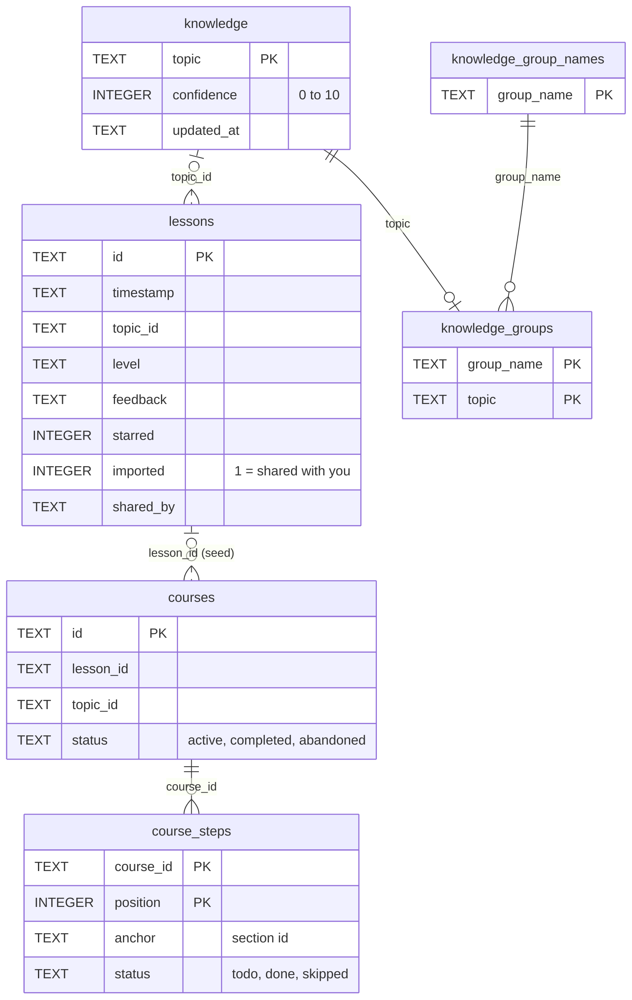

# Your data

import FileTree from "@site/src/components/FileTree";
import RefTable from "@site/src/components/RefTable";
import Terminal from "@site/src/components/Terminal";
import WideDiagram from "@site/src/components/WideDiagram";
import cli from "@site/src/data/cli-output.json";

Everything devcoach keeps on your computer: where it lives, what a backup holds, what a restore does,
how to reset, and the database. The settings and the pacing rules are on
[Configuration](configuration.md).

## Where it lives {/* #data-location */}

Your coaching data lives in `~/.devcoach/`: a SQLite database (`coaching.db`), the coaching notebook
(`learning-state.md`) and your course files (`courses/`).

<FileTree
  root="~/.devcoach/"
  items={[
    {
      name: "coaching.db",
      note: "the database: lessons, knowledge map, settings, the course index and the pacing counters. Created the first time devcoach needs it.",
    },
    {
      name: "learning-state.md",
      note: "the coaching notebook. Your agent writes it at onboarding and updates it at notebook checkpoints. The dashboard's Settings page shows it, read-only; to change it, edit this file.",
    },
    {
      name: "courses/",
      note: "one folder per course",
      children: [{ name: "<id>/index.html", note: "the course document your agent wrote" }],
    },
    {
      name: "hook.log",
      note: (
        <>
          only while <code>DEVCOACH_HOOK_DEBUG=1</code> is set; emptied once it passes 256 KB
        </>
      ),
    },
    {
      name: "gemini-ext/",
      note: "Gemini CLI extension only: the copy of devcoach it installs and runs. Not in backups.",
    },
  ]}
/>

devcoach has no account, no telemetry and no update check. It makes one kind of network request, and
only when you ask: importing a lesson from a web address downloads that page. Your data leaves the
machine only when you share a lesson or publish a course; as with anything in a session, what your agent
reads from devcoach becomes part of its conversation with its model. Every guarantee, with its limits,
is on [Privacy & security](privacy.md).

## Back up and restore {/* #backup-strategy */}

A backup is one zip with your settings, knowledge map, lessons, the notebook and your courses. It is not
encrypted, and it holds local folder paths (the folder each lesson was recorded in): keep it where you
would keep the data itself.

<Terminal command="devcoach backup devcoach-backup.zip" output={cli.backup} />

Without a file name, `devcoach backup` writes `devcoach-backup.zip` in the current folder. The count
covers lessons and topics; the zip holds the notebook and courses too. The dashboard's Settings page has
the same backup (*Download backup*) and restore (*Restore backup*).

```bash
# Every day, from a script or a scheduled task
# (in a crontab line, write each % as \%)
devcoach backup ~/Backups/devcoach-$(date +%Y%m%d).zip

# Before a big change
devcoach backup devcoach-before-reset.zip
```

A restore never removes a lesson, a topic or a course. It adds what you are missing; for your settings,
the notebook and the topics you both have, the backup wins:

<RefTable wideName>

| In the zip | What restore does with it | Effect |
|---|---|---|
| `settings.json`<br/>the seven settings | Replaces yours with the backup's. A backup without a `share_name` leaves yours. | **replaces** |
| `knowledge.json`<br/>topics, confidence, groups | Adds topics and groups. A topic you already have takes the backup's confidence, and its group when the backup gives one. Topics you added since stay. | merges |
| `lessons.json`<br/>every lesson, shared ones too | Adds each lesson whose id you do not have, so a deleted lesson comes back. A lesson you have stays as it is, with its star and your answer. | *adds* |
| `learning-state.md`<br/>the notebook, when there is one | Replaces your notebook with the backup's. | **replaces** |
| `courses.json`<br/>`courses/<id>/index.html`<br/>each course, its steps and document | Adds the courses you do not have, with their documents. A course you have, and its document, stay as they are. | *adds* |

</RefTable>

The pacing counters and `hook.log` are never in a backup.

<Terminal command="devcoach restore ~/Downloads/devcoach-backup.zip" output={cli.restore} />

Courses are restored too; the command prints no line for them. The same restore runs from the
dashboard, from the first step of `devcoach setup`, and when you pick *Import backup* at onboarding.

## Reset {/* #reset */}

**Rebuild your map, keep your lessons.** Your agent asks how you want to set up, replaces every topic
and group, and rewrites the notebook, keeping its earlier notes. Lessons, courses and settings stay.

```bash
devcoach backup before-reset.zip
# then ask your agent: redo onboarding
```

In a terminal, `devcoach setup` also replaces every topic and group, with two differences. It asks
again for the lessons per day and the gap, offering 2 and 240 (not your current values), so pressing
Enter resets them. And it leaves the notebook as it was.

**Start from nothing.** Deleting the folder removes the database, the notebook and the courses; on your
next task, devcoach offers onboarding again (in an agent with hooks; elsewhere say *set up devcoach*).

```bash
devcoach backup before-reset.zip   # optional
rm -r ~/.devcoach
```

Deleting only `coaching.db` would leave the notebook and the courses behind. With the Gemini CLI
extension, the folder also holds the extension's copy of devcoach, which the extension installs again.
Removing devcoach as well? `devcoach uninstall --data` takes it out of your agents and deletes
`~/.devcoach` after asking.

## Two devcoach versions, one database {/* #two-versions */}

Two installs on one computer (the plugin and Homebrew, say) share one database. When the newer one
upgrades it, the older one opens it read-only and never changes it:

<RefTable>

| Where | What happens with the older devcoach |
|---|---|
| CLI | Reads work; `stats`, `profile` and `lessons` end with a yellow note. A write is refused with a message that names both versions, and the command exits with status 3. |
| Dashboard | A banner says so. Pages that read keep working; a save is refused. |
| Your agent | devcoach's tools read as usual and refuse to save, saying why. No reply is counted and no lesson is cued. |
| `devcoach doctor` | Shows it in red under *Database & pacing*. |

</RefTable>

To fix it, update the older install (`brew upgrade devcoach`, `npm install -g devcoach@latest`, or
update the plugin), or use only the newer one.

## The database {/* #database-schema-reference */}

Seven tables hold your data. Six are drawn below; the seventh, `settings`, holds one row per setting
(`key`, `value`). The links between tables are by value: SQLite does not enforce them.

<WideDiagram label="Six tables of the database and how they relate">



</WideDiagram>

`lessons` has 19 columns; the diagram shows the ones you would ask about. Three more tables hold runtime
state and are never backed up: `nudge_state` (the reply counter of each of the 50 most recent sessions),
`cue_state` (whether a cue is waiting for an answer, and the last skip reason) and `schema_migrations`
(one-off data fixes already applied).

<details>
<summary>The full schema (SQL)</summary>

```sql
CREATE TABLE IF NOT EXISTS lessons (
    id                  TEXT PRIMARY KEY,
    timestamp           TEXT NOT NULL,
    topic_id            TEXT NOT NULL,
    categories          TEXT NOT NULL,
    title               TEXT NOT NULL,
    level               TEXT NOT NULL,
    summary             TEXT NOT NULL,
    body                TEXT,
    task_context        TEXT,
    project             TEXT,
    repository          TEXT,
    branch              TEXT,
    commit_hash         TEXT,
    folder              TEXT,
    feedback            TEXT,
    repository_platform TEXT,
    starred             INTEGER NOT NULL DEFAULT 0,
    imported            INTEGER NOT NULL DEFAULT 0,
    shared_by           TEXT
);

CREATE TABLE IF NOT EXISTS knowledge (
    topic       TEXT PRIMARY KEY,
    confidence  INTEGER NOT NULL DEFAULT 5,
    updated_at  TEXT NOT NULL
);

CREATE TABLE IF NOT EXISTS settings (
    key   TEXT PRIMARY KEY,
    value TEXT NOT NULL
);

CREATE TABLE IF NOT EXISTS knowledge_group_names (
    group_name TEXT PRIMARY KEY
);

CREATE TABLE IF NOT EXISTS knowledge_groups (
    group_name TEXT NOT NULL,
    topic      TEXT NOT NULL,
    PRIMARY KEY (group_name, topic)
);

CREATE TABLE IF NOT EXISTS courses (
    id            TEXT PRIMARY KEY,
    lesson_id     TEXT,
    topic_id      TEXT NOT NULL,
    title         TEXT NOT NULL,
    goal          TEXT,
    prerequisites TEXT NOT NULL DEFAULT '[]',
    status        TEXT NOT NULL DEFAULT 'active',
    created_at    TEXT NOT NULL,
    updated_at    TEXT NOT NULL,
    completed_at  TEXT
);

CREATE TABLE IF NOT EXISTS course_steps (
    course_id  TEXT NOT NULL,
    position   INTEGER NOT NULL,
    title      TEXT NOT NULL,
    kind       TEXT NOT NULL,
    anchor     TEXT NOT NULL,
    status     TEXT NOT NULL DEFAULT 'todo',
    done_at    TEXT,
    PRIMARY KEY (course_id, position)
);

CREATE TABLE IF NOT EXISTS schema_migrations (
    name       TEXT PRIMARY KEY,
    applied_at TEXT NOT NULL
);

CREATE TABLE IF NOT EXISTS nudge_state (
    session_id    TEXT PRIMARY KEY,
    interactions  INTEGER NOT NULL DEFAULT 0,
    updated_at    TEXT NOT NULL
);

CREATE TABLE IF NOT EXISTS cue_state (
    id               INTEGER PRIMARY KEY CHECK (id = 1),
    pending          INTEGER NOT NULL DEFAULT 0,
    last_cue_at      TEXT,
    last_skip_reason TEXT
);

CREATE INDEX IF NOT EXISTS idx_courses_lesson_id ON courses (lesson_id);
CREATE UNIQUE INDEX IF NOT EXISTS idx_course_steps_anchor ON course_steps (course_id, anchor);
CREATE INDEX IF NOT EXISTS idx_lessons_timestamp ON lessons (timestamp);
CREATE INDEX IF NOT EXISTS idx_lessons_starred_ts ON lessons (starred, timestamp);
CREATE INDEX IF NOT EXISTS idx_lessons_feedback ON lessons (feedback);
CREATE INDEX IF NOT EXISTS idx_lessons_topic_id ON lessons (topic_id);
```

- `lessons`: `categories` is a JSON array; `level` is `junior`, `mid` or `senior`; `body` is the
  lesson's markdown; `feedback` is `know`, `understood`, `dont_know` or NULL; `repository_platform`
  is `github`, `gitlab`, `bitbucket` or `local`; `imported` = 1 marks a lesson shared with you, and
  `shared_by` holds its sender's name (NULL when anonymous). `timestamp` is ISO 8601 in UTC, stamped
  by devcoach when a lesson is saved.
- `courses` (schema version 5, devcoach 2.5.0): `prerequisites` is a JSON array of `{concept, known}`
  from the questions before a course.
- `course_steps`: `kind` is `concept`, `example`, `practice` or `check`; `anchor` is the id of the
  step's section in the course document, one step per section.
- The schema is at version 6 (`PRAGMA user_version`). Two rows of `settings`, `schema_app_version`
  and `schema_min_app_version`, record which devcoach last upgraded it and the oldest one that may
  write to it.

</details>
