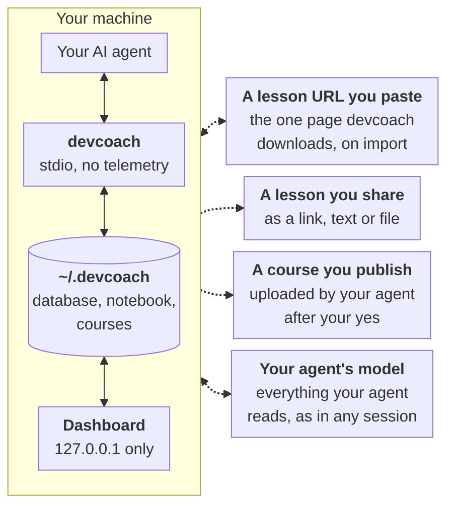

import { Cards, Card } from "@site/src/components/Cards";
import { Chat, Say, Choices } from "@site/src/components/Chat";
import { StackTable } from "@site/src/components/StackTable";
import Tabs from "@theme/Tabs";
import TabItem from "@theme/TabItem";

# Privacy & security

devcoach is **local-first and single-user by design**. Everything it does happens on the machine where your
agent runs.

<Cards columns={3}>
  <Card label="Stays local" title="No account, no telemetry" to="#where-your-data-lives">
    Your coaching data lives in `~/.devcoach/` on your computer. devcoach sends nothing home and never checks for updates.
  </Card>
  <Card label="What is read" title="Metadata and short notes" to="#what-devcoach-reads">
    Setup reads project paths, file names, dependency lists, activity counts and up to 1200 characters of each `MEMORY.md`, and never keeps your prompts. Conversation text only with Automatic (Deep), read by your agent.
  </Card>
  <Card label="What leaves" title="What you hand over" to="#sharing-is-explicit">
    A lesson you share, a course you publish, and what your agent sends its model. devcoach's one download: a lesson URL you paste.
  </Card>
</Cards>

## Where your data lives

- **Your coaching data lives in `~/.devcoach/`**: the database `coaching.db`, the coaching notebook
  `learning-state.md`, your [courses](../usage/courses.md) under `courses/`, and `hook.log` if you turn
  on hook tracing. devcoach writes elsewhere only when you ask: its entries in your agent's settings
  (`devcoach install`; `devcoach uninstall` removes them), a backup, a shared `.devcoach.md` file.
- **No account, no telemetry, no update check.** Installing or updating devcoach uses the network like
  any install.
- **Nothing listens on the network.** devcoach talks to your agent over stdio. The optional dashboard
  listens on `127.0.0.1` only.



Solid arrows stay on your machine; dashed arrows cross its edge. Your agent's conversation with its model
includes whatever it reads from devcoach, as in any session.

**One network request, only when you ask.** Importing a lesson from a web address, from the CLI, the
`import_lesson` tool or the dashboard, downloads that one page: public hosts only, at most 256 KB,
5 seconds and 3 redirects. The request names itself `devcoach/<version>` and carries nothing from your
coaching data. Through the tool it is your agent that passes the URL; the devcoach skill tells it to
use only one you pasted.

## What devcoach reads

devcoach only reads these sources; it never changes them. The setup scan suggests your first topics: it
runs when onboarding starts, before you pick a mode, and when you ask the coach to review or rebuild your
profile or notebook. Nothing from it is stored. Your agent gets the result and saves only the topics and
notebook it builds.

<StackTable>
  <table>
    <thead>
      <tr>
        <th style={{ width: "28%" }}>Source</th>
        <th style={{ width: "40%" }}>What devcoach reads</th>
        <th style={{ width: "32%" }}>What it keeps or passes on</th>
      </tr>
    </thead>
    <tbody>
      <tr>
        <th colSpan={3} scope="rowgroup">The setup scan, over your 15 most recently active projects</th>
      </tr>
      <tr>
        <th scope="row">`~/.claude.json`</th>
        <td data-label="What devcoach reads">Parsed in full. devcoach uses the **project paths** and each project's **`exampleFiles` list**, of which only the file extensions count (`.ts` → typescript)</td>
        <td data-label="Keeps or passes on">Your agent gets each scanned project's name and **full path**</td>
      </tr>
      <tr>
        <th scope="row">Each project's folder</th>
        <td data-label="What devcoach reads">**File names**, two levels deep (at most 40 folders per project, 400 in all), and the **dependency lists** in `package.json`, `requirements*.txt` and `pyproject.toml`</td>
        <td data-label="Keeps or passes on">Your agent gets the topics found</td>
      </tr>
      <tr>
        <th scope="row">`~/.claude/history.jsonl`</th>
        <td data-label="What devcoach reads">Each line is parsed and **only `project` and `timestamp` are kept**. The prompt text is dropped at once</td>
        <td data-label="Keeps or passes on">Your agent gets a prompt count and the last activity date per project. **Never the text**</td>
      </tr>
      <tr>
        <th scope="row">Each project's auto-memory `MEMORY.md`</th>
        <td data-label="What devcoach reads">Notes Claude Code wrote about the project: **the first 1200 characters**</td>
        <td data-label="Keeps or passes on">Your agent gets those 1200 characters</td>
      </tr>
    </tbody>
    <tbody>
      <tr>
        <th colSpan={3} scope="rowgroup">Every prompt and every finished task</th>
      </tr>
      <tr>
        <th scope="row">Your agent's hook events</th>
        <td data-label="What devcoach reads">The JSON your agent sends, which can include your prompt. **Only the session id, the permission mode and one flag are kept**; the rest is dropped</td>
        <td data-label="Keeps or passes on">A counter per chat session, in your local database</td>
      </tr>
    </tbody>
    <tbody>
      <tr>
        <th colSpan={3} scope="rowgroup">Each lesson</th>
      </tr>
      <tr>
        <th scope="row">Your working folder</th>
        <td data-label="What devcoach reads">Project, repository, branch and commit through `git`, plus the **folder path**</td>
        <td data-label="Keeps or passes on">Stored with the lesson; your agent sees it when it reads your lessons. Shared only in a [lesson you share](#sharing-is-explicit) with *Include where it happened* (never the folder path) or a [course you publish](#publishing-a-course-as-an-artifact) that names it</td>
      </tr>
    </tbody>
    <tbody>
      <tr>
        <th colSpan={3} scope="rowgroup">Only with Automatic (Deep), and read by your agent, not devcoach</th>
      </tr>
      <tr>
        <th scope="row">Your Claude Code sessions, `~/.claude/projects/`<wbr/>`<project>/*.jsonl`</th>
        <td data-label="What your agent reads">**Real conversation text**, read by a subagent your agent starts (see below)</td>
        <td data-label="Keeps or passes on">devcoach stores the topics, groups and notebook your agent saves. What the subagent reads goes to your agent's model</td>
      </tr>
    </tbody>
  </table>
</StackTable>

<details>
<summary>One project, exactly as your agent receives it</summary>

The real scan, run on a sample project: a folder with `package.json`, `tsconfig.json` and a `Dockerfile`,
three lines in `history.jsonl` and a short `MEMORY.md`. This is its entry in `detected_projects`, the
list `get_onboarding` returns (`path` is absolute: the sandbox home is shown as `~`, and the list is on
one line):

```json
{
  "name": "shop-api",
  "path": "~/code/shop-api",
  "topics": ["docker", "express", "git", "javascript", "sql", "typescript"],
  "prompt_count": 3,
  "last_activity": "2026-11-21T22:29:40.000Z",
  "memory": "# shop-api memory\n- Payments go through the /webhooks/stripe handler; retries must be idempotent.\n- Postgres migrations live in migrations/, run with npm run migrate."
}
```

The three history lines held the prompt *"make the webhook retry idempotent"*; only their count is here.
`sql` comes from the `exampleFiles` list in `~/.claude.json`.

</details>

:::info[Automatic (Deep): your agent reads your conversations]

devcoach's own code never opens your session transcripts. If you choose Deep:

1. The skill calls `preview_deep_scan`, which reads only project paths and activity dates, never prompt
   text, and lists the projects you worked on in the last 3 months so you can narrow the list.
2. Your agent starts a subagent that reads conversation text from `~/.claude/projects/<project>/*.jsonl`.
   The skill tells it to read at most 25 projects and the 5 most recent sessions of each, to prefer
   observations over quotes, and to answer with only topics, groups and notebook notes.

These are instructions to a model, which devcoach cannot enforce, and what the subagent reads goes to
your agent's model. Automatic and Guided do not ask your agent to read your conversations.

:::

## Sharing is explicit

Your data leaves your machine when you hand it over: a [lesson you share](../usage/sharing.md) or a course
you publish (next section). Here is a real share, decoded: `devcoach share --last` on the demo data, with
the git name *Sam Rivera*. The highlighted lines describe you and your copy of the lesson, or, in the
second tab, where it happened.

<Tabs>
<TabItem value="default" label="Default">

```json title="devcoach share --last (long strings shortened)" {13-14,16-18}
{
  "format": "devcoach.lesson",
  "version": 1,
  "lesson": {
    "title": "Cache stampede — when every server hits the DB at the same moment",
    "summary": "A cache stampede happens when a popular key expires and…",
    "body": "Imagine a cache key that covers your most-viewed product page…",
    "topic_id": "redis_cache_stampede",
    "categories": ["redis", "performance_optimization", "software_architecture"],
    "level": "senior"
  },
  "origin": {
    "id": "lesson-redis-cache-stampede-001",
    "timestamp": "2026-04-28T10:00:00Z"
  },
  "shared_by": "Sam Rivera",
  "shared_at": "2026-11-22T01:03:02Z",
  "app_version": "2.7.1"
}
```

</TabItem>
<TabItem value="context" label="With “Include where it happened”">

```json title="devcoach share --last --with-context (long strings shortened)" {11-16}
{
  "format": "devcoach.lesson",
  "version": 1,
  "lesson": {
    "title": "Cache stampede — when every server hits the DB at the same moment",
    "summary": "A cache stampede happens when a popular key expires and…",
    "body": "Imagine a cache key that covers your most-viewed product page…",
    "topic_id": "redis_cache_stampede",
    "categories": ["redis", "performance_optimization", "software_architecture"],
    "level": "senior",
    "task_context": "Debugging a production incident where Redis cache expiry caused database overload spikes",
    "project": "dev-coach",
    "repository": "developer/dev-coach",
    "branch": "main",
    "commit_hash": "d3ae15d8041a1c0f421834ef8cb5b83f10d7d851",
    "repository_platform": "github"
  },
  "origin": {
    "id": "lesson-redis-cache-stampede-001",
    "timestamp": "2026-04-28T10:00:00Z"
  },
  "shared_by": "Sam Rivera",
  "shared_at": "2026-11-22T01:03:02Z",
  "app_version": "2.7.1"
}
```

</TabItem>
</Tabs>

- **Your name goes with the lesson unless you remove it.** It comes from the `share_name` setting,
  else your git `user.name`. The dashboard shows it in an editable field first; in a terminal use
  `--anonymous` (or `--by <name>`); in chat, say *anonymously*.
- **Always included:** the lesson's id and the date you learned it (`origin`), the date you shared it
  and your devcoach version.
- **Where it happened, only on request** (*Include where it happened*, `--with-context`): task,
  project, branch and commit, plus the repository when it is on GitHub, GitLab or Bitbucket.
  **Never a local folder path.**
- **The share link is server-less.** The lesson rides in the URL fragment, which browsers never send to
  the site; the docs page decodes it in your browser.

[Sharing lessons](../usage/sharing.md#what-travels--and-what-never-does) describes every field.

## Publishing a course as an artifact

A [course](../usage/courses.md) is a file on your disk. When your agent has Claude's Artifact tool, the
devcoach skill has the coach offer to publish it, once per course:

<Chat label="The offer, in the devcoach skill's words">
  <Say who="coach">*Publish this course as a Claude artifact too? That **uploads a copy to claude.ai** — it leaves this machine. Only you can open it until you share the link.* *It mentions lolcoach and the hang you debugged.*</Say>
  <Choices options={["Yes", "No"]} />
</Chat>

- **It is an upload.** The copy is stored on Anthropic's servers under your account; "private" means
  only you can open the link until you share it.
- **Look before you say yes.** Courses take their examples from your work: project and repository
  names, file paths, snippets, the bug you were chasing.
- **These are instructions to the coach:** ask before every publish and republish, name what the course
  mentions, never publish without a yes. devcoach cannot enforce them; your agent's Artifact tool does
  the upload.
- **devcoach keeps no record of it**: no link, no flag in the database. Manage or delete published
  artifacts on claude.ai.

## A lesson someone shares with you

A shared lesson is text someone else wrote, and devcoach treats it that way:

- **Nothing is saved until you say so:** *Add to my lessons* on the dashboard, or an import you run.
- **Escape sequences and control characters are stripped**, with invisible characters that reorder
  text, when the lesson is imported and again before the CLI prints it.
- **Its markdown is sanitised** before the dashboard or the docs page shows it.
- **A code is size-checked before it is unpacked:** at most 64,000 characters, and 256 KB decompressed.
- **A URL import reaches public addresses only**, checked after DNS resolution and on every redirect;
  devcoach connects to exactly the address it checked.

Your agent still reads it as someone else's text; devcoach does not filter what it says.

## The dashboard answers only itself

`devcoach ui` listens on `127.0.0.1`, so no other machine can reach it. On your own machine, every
request passes two checks first:

- **Another website cannot change anything.** Your browser tells the dashboard which site sent a
  request, and every action that writes refuses other sites with *403 Forbidden*, the docs site's share
  page included. Reads still work: that is how the share page sees that your dashboard is running (the
  answer is only its status and version) and opens the import preview, where only your click on
  *Add to my lessons* saves the lesson.
- **Only its own address.** A request must be addressed to `127.0.0.1`, `localhost` or `[::1]`, so a
  page served under another name that resolves to your machine (DNS rebinding) is refused, reads
  included.

## Backups are plain files

`devcoach backup` (or *Download backup* in the dashboard's settings) produces an **unencrypted** zip:
settings, knowledge map, lessons, courses and the notebook. Unlike a shared lesson, it holds everything,
task context and local folder paths included, and so does *Download lessons* (the lessons as JSON).
Lessons can include snippets of your project context, so store these files somewhere you trust. See
[Backup, export & import](../usage/cli.md#backup-export--import).

## Why it can't be a hosted / remote connector

claude.ai web connects only to remote MCP servers that it reaches over the internet. devcoach keeps
your data in your home directory, so it has to run on your computer: that local-only constraint is the
whole point. claude.ai web is therefore not supported. You can paste the devcoach skill into it by hand
([claude.ai web](../install/claude-ai.md)), which gives the coaching behaviour without any data storage.
