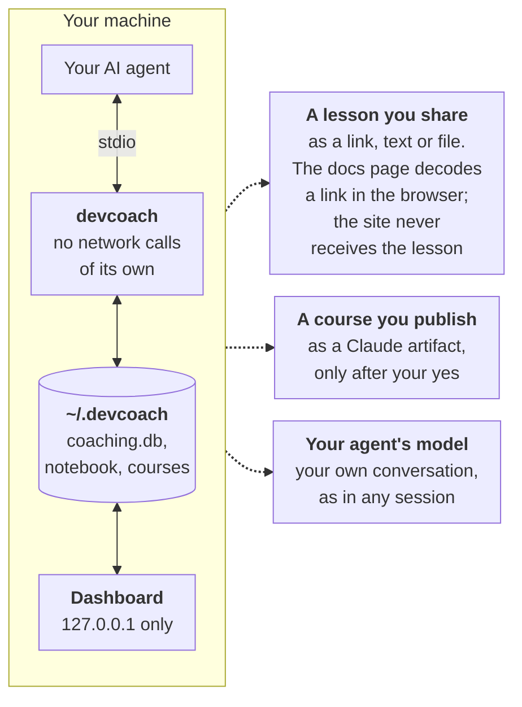

import { Cards, Card } from "@site/src/components/Cards";

# Privacy & security

devcoach is **local-first and single-user by design**. Everything it does happens on the machine where your
agent runs.

<Cards columns={3}>
  <Card label="Stays local" title="One SQLite file, no account" to="#everything-stays-on-your-machine">
    All your data lives in `~/.devcoach/coaching.db`, with an optional notebook and your courses beside it. No network calls of its own, no telemetry.
  </Card>
  <Card label="What is read" title="Metadata, never what you typed" to="#what-devcoach-reads">
    Automatic onboarding reads project paths, manifests, activity timestamps and at most 1200 characters of each `MEMORY.md`. Conversation text only with Automatic (Deep), when you choose it.
  </Card>
  <Card label="What leaves" title="Two things, only when you ask" to="#sharing-is-explicit">
    A lesson you share, as a link, text or file, and a course you publish as a Claude artifact. A shared lesson never carries a local folder path.
  </Card>
</Cards>

## Everything stays on your machine

- All your data lives in **one SQLite file**: `~/.devcoach/coaching.db` (plus an optional
  `~/.devcoach/learning-state.md` notebook and the [courses](../usage/courses.md) you create, under
  `~/.devcoach/courses/`). Nothing else, nowhere else.
- devcoach makes **no network calls of its own** and sends **no telemetry**. Your knowledge map, lessons,
  feedback, and project/git context never leave your computer.
- It runs as a local **stdio** process started by your agent — there's no server to expose, no account, and
  no login.

Solid arrows stay on your machine. Dashed arrows cross its edge: the two ways your data can leave, only
when you ask for it, and your agent's own conversation with its model, as in any session.

## What devcoach reads

During automatic onboarding devcoach reads a small set of **metadata** sources, locally and read-only,
to suggest topics — never the content of what you typed. The table lists them, with the git metadata
devcoach reads for your lessons and the conversation text that only Automatic (Deep) reads.

<table>
  <thead>
    <tr>
      <th>Source</th>
      <th>What is read</th>
      <th>Stored</th>
      <th>Leaves your machine</th>
    </tr>
  </thead>
  <tbody>
    <tr>
      <th colSpan={4} scope="rowgroup" style={{ textAlign: "left" }}>During Automatic onboarding</th>
    </tr>
    <tr>
      <td>`~/.claude.json` projects map</td>
      <td>**Project paths only**</td>
      <td rowSpan={4}>No. Only the topics and notebook built from it are saved</td>
      <td rowSpan={4}>Only as part of your own conversation with the model: your agent reads the result to build your topics</td>
    </tr>
    <tr>
      <td>Each project's folder</td>
      <td>Manifests and lockfiles, via a depth-limited directory walk</td>
    </tr>
    <tr>
      <td>`~/.claude/history.jsonl`</td>
      <td>**Only the `project` and `timestamp` fields** of each line, to rank projects by recent activity. The prompt text on those lines is never read</td>
    </tr>
    <tr>
      <td>Each project's auto-memory `MEMORY.md`</td>
      <td>**At most 1200 characters**</td>
    </tr>
  </tbody>
  <tbody>
    <tr>
      <th colSpan={4} scope="rowgroup" style={{ textAlign: "left" }}>For your lessons</th>
    </tr>
    <tr>
      <td>Your working directory</td>
      <td>Git metadata, auto-detected: project, repository, branch, commit</td>
      <td>Only in your local database, purely to give lessons useful context</td>
      <td>Only in a [lesson you share](#sharing-is-explicit) with *Include where it happened* (never the local folder path), or a [course you publish](#publishing-a-course-as-an-artifact) that names it</td>
    </tr>
  </tbody>
  <tbody>
    <tr>
      <th colSpan={4} scope="rowgroup" style={{ textAlign: "left" }}>Only with Automatic (Deep), opt-in</th>
    </tr>
    <tr>
      <td>Your local Claude Code session history, `~/.claude/projects/` `<project>/*.jsonl`</td>
      <td>**Real conversation text**, at most the 5 most recent sessions per project</td>
      <td>Only the synthesized topics, groups, and notebook notes</td>
      <td>Only as part of your own conversation with the model, same as anything else in that session</td>
    </tr>
  </tbody>
</table>

Only the 15 most recently active projects are scanned, and any failure degrades to an empty scan.
devcoach itself makes no network calls; the only subprocesses it runs are `git` (for the git metadata)
and, for the plugin / extension bootstrap, a one-time `npm install` of the pinned package.

:::info[Automatic (Deep) onboarding is the one explicit exception]

It's an opt-in tier you choose at setup time, clearly labeled as such. If you pick it:

1. The skill first calls `preview_deep_scan`, a metadata-only pre-check that lists which projects fall
   inside the chosen date window and lets you narrow it.
2. Only then does it spawn a separate subagent that reads real conversation text from your local Claude
   Code session history (`~/.claude/projects/<project>/*.jsonl`, at most the 5 most recent sessions per
   project).
3. That subagent returns only synthesized topics, groups, and notebook notes. The raw transcripts never
   enter your main conversation.

Nothing leaves your machine except as part of your own conversation with the model, same as anything
else in that session. Standard Automatic and Guided onboarding never read this content — only Deep
does, and only when you choose it.

:::

## Sharing is explicit

Your data leaves your machine in exactly two ways, and only when you ask for it:
[sharing a lesson](../usage/sharing.md), and publishing a course as a Claude artifact (next
section). For a lesson:

- **Only the lesson travels by default** — title, summary, body, topic, categories and level. Project,
  branch, commit and task context are included only with an explicit *Include where it happened* /
  `--with-context` / `include_context`; a **local folder path is never exported**, and a repository
  name only when it points at a remote host (GitHub, GitLab, Bitbucket).
- **The share link is server-less** — the lesson is encoded in the URL fragment, which browsers never
  send to the site; the docs page decodes it locally. devcoach still makes no network calls of its own:
  the only outbound request is `devcoach import <url>` fetching a URL *you* pasted.
- **Your name is opt-in** — proposed from `share_name` or git `user.name`, editable, and
  "anonymous" is always available.
- **Nothing is saved on the receiving side until you click** *Add to my lessons* (or run the import).

## Publishing a course as an artifact

A [course](../usage/courses.md) is a file on your disk. In a client that has the Artifact tool
(Claude Code, claude.ai) the coach offers, once per course, to publish it as a Claude artifact:

- **It is an upload.** Saying yes sends a copy of the course document to claude.ai, stored on
  Anthropic's servers under your account. "Private" means only you can open the link until you
  share it — it does not mean the file stayed local.
- **Look at what it contains first.** Courses draw their examples from the work that triggered
  the lesson: project and repository names, file paths, snippets, the bug you were chasing. The
  coach names what the document mentions when it asks.
- **Nothing happens without a yes**, and the question is asked again for every republish.
- **devcoach keeps no record of it** — no link, no flag in the database. The upload is done by
  your client's Artifact tool, not by devcoach, which still makes no network calls of its own.
  Manage or delete published artifacts from your artifacts on claude.ai.

## The dashboard answers only itself

`devcoach ui` listens on `127.0.0.1`, so no other machine can reach it. On your own machine, every
request passes two checks before any page or action runs:

- **Another website cannot change anything.** Your browser tells the dashboard which site started a
  request; a form or script on any other site — the docs site's share page included — gets
  *403 Forbidden* for every action that writes. Reading is unaffected: that is how the share page
  checks that your dashboard is running and opens the import preview. The lesson is saved only when
  you click *Add to my lessons* on the dashboard itself.
- **Only its own address.** A request must be addressed to `127.0.0.1` or `localhost`. A page served
  under another name that resolves to your machine (DNS rebinding) is refused, reads included.

## Backups are plain files

`devcoach backup` produces an **unencrypted** zip (settings, knowledge map, lessons, courses, and the
notebook). Lessons can include snippets of your project context, so treat backups like any other
sensitive working file and store them somewhere you trust. See
[Backup, export & import](../usage/cli.md#backup-export--import).

## Why it can't be a hosted / remote connector

claude.ai web and other "remote MCP" connectors require a multi-tenant HTTP/OAuth server. devcoach
deliberately writes to your local home directory, so it **cannot** run as a remote connector — that
local-only constraint is the whole point. On claude.ai you can still use the
[skill copy](../install/claude-ai.md), which provides the coaching behaviour without any data storage.
