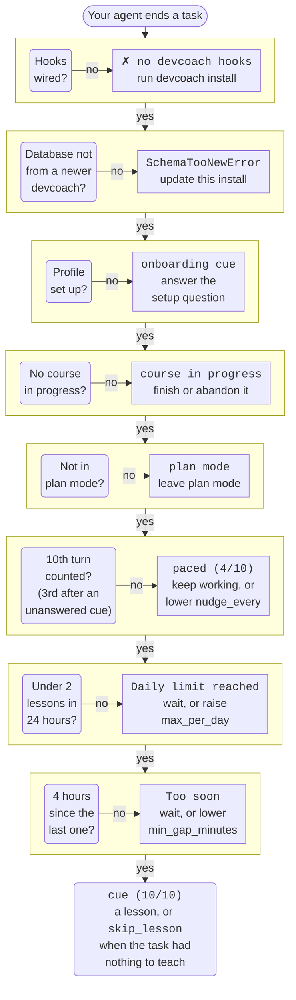

# Troubleshooting

import Link from "@docusaurus/Link";
import Message from "@site/src/components/Message";
import Tabs from "@theme/Tabs";
import TabItem from "@theme/TabItem";
import Terminal from "@site/src/components/Terminal";
import cli from "@site/src/data/cli-output.json";

export const doctorPlugin = "\n\u001b[1mdevcoach doctor\u001b[22m \u001b[2mv2.7.1\u001b[22m\n\n\u001b[1mEnvironment\u001b[22m\n  \u001b[32m✓\u001b[39m Node 24.22.3 via nvm (≥ 24)\n  \u001b[32m✓\u001b[39m this devcoach: claude-plugin (~/.claude/plugins/data/devcoach-ultimaphoenix/runtime/2.7.1/node_modules/devcoach)\n  \u001b[32m✓\u001b[39m Runtime: devcoach plugin · devcoach 2.7.1 · ~/.claude/plugins/data/devcoach-ultimaphoenix/runtime/2.7.1\n\u001b[1m\nClaude Code wiring\u001b[22m\n  \u001b[32m✓\u001b[39m hooks provided by the devcoach plugin\n  \u001b[32m✓\u001b[39m Claude Code skill bundled with the plugin\n\u001b[1m\nDatabase & pacing\u001b[22m\n  \u001b[32m✓\u001b[39m database opens (~/.devcoach/coaching.db)\n  \u001b[32m✓\u001b[39m schema v6, last upgraded by devcoach 2.7.1\n  \u001b[32m✓\u001b[39m onboarding complete\n    settings: max_per_day=2 · min_gap_minutes=240 · nudge_every=10 · nudge_scope=session\n    pacing: 0 session(s) counted, 0 interaction(s) total\n  \u001b[32m✓\u001b[39m rate limit: allowed\n\u001b[1m\nVerdict\u001b[22m\n  \u001b[33m→\u001b[39m the next eligible stop would NOT cue a lesson:\n      · pacing: next stop would be 1/10\n      · rate limit: allowed";

Find the message on your screen in this table and follow its link; with no message at all, start
with [`devcoach doctor`](#doctor).

## If you see this {/* #symptoms */}

| You see | Go to |
|---|---|
| `devcoach 2.7.1 needs Node 24 or newer` | [Node too old](#node-version-error) |
| `Node 22.22.0 is too old: devcoach needs Node 24 or newer` | [Node too old](#node-version-error) |
| `plugin:devcoach:devcoach` failed to connect | [Can't start](#mcp-server-not-connecting) |
| `🎓 devcoach is not running: …` | [Can't start](#mcp-server-not-connecting) |
| `Failed to spawn process: No such file or directory` in Claude Desktop's log | [Can't start](#mcp-server-not-connecting) |
| `Stop hook error occurred` next to a lesson | [Harmless](#stop-hook-error) |
| `Failed with non-blocking status code:` on every turn, with `…/bin/devcoach: not found` | [After uninstalling](#uninstalling) |
| `The coaching database was upgraded by devcoach …` and `Reads work; writes need devcoach ≥ …` | [Newer database](#database-newer) |
| `attempt to write a readonly database`, `unable to open database file` or `EACCES: permission denied` | [Permissions](#sqlite-permission-error) |
| `devcoach hooks are registered TWICE`, `2 devcoach plugins enabled` or `2 devcoach Stop entries` | [Counted twice](#hooks-twice) |
| `Failed to install plugin devcoach@ultimaphoenix: … invalid manifest` | [Old manifest](#invalid-manifest) |
| No message, and no lesson | [No lesson](#no-lessons) |
| A `✗` or `→` line in `devcoach doctor` | [Reading doctor](#doctor) |

## Reading `devcoach doctor` {/* #doctor */}

`devcoach doctor` checks the whole wiring, changes nothing, and ends with a **Verdict**: would the
next turn bring a lesson, and why. Without a `devcoach` command, run `npx -y devcoach doctor`. With
the Claude Code plugin, type **`/devcoach:setup`**, which runs the plugin's own check (or run it from
a terminal: [plugin page](./install/claude-code-plugin.md#troubleshooting)).

<Tabs>
<TabItem value="wired" label="Wired" default>

<Terminal
  command="devcoach doctor"
  output={cli.doctor}
  maxLines={16}
  caption="An npm global install under nvm, after devcoach install, with lessons. Every check passes; the → lines are notes."
/>

</TabItem>
<TabItem value="not-wired" label="Not wired yet">

<Terminal
  command="devcoach doctor"
  output={cli.doctorNotInstalled}
  caption="The same install before devcoach install and before the first task. The ✗ line and the skill's → line name the command that fixes them; no database yet is normal before the first task."
/>

</TabItem>
<TabItem value="plugin" label="With the plugin">

<Terminal
  command="node …/scripts/launch.mjs doctor"
  output={doctorPlugin}
  caption="The Claude Code plugin, through its launcher. It adds a Runtime line; the hooks and the skill come from the plugin, and its server needs no entry of its own."
/>

</TabItem>
</Tabs>

| Mark | What it means |
|:---:|---|
| **✓** | The check passed |
| **→** | Worth reading. Either a note about your setup (`bound to Node …`, `no database yet`), or a missing part with the command that adds it (`— run devcoach install`) |
| **✗** | Broken: that part cannot work. The line says what to run |

- **`bound to Node v24.22.3 (nvm)`**: devcoach lives inside that one Node version. After removing or
  switching it, run `devcoach install --force`.
- **Verdict**: `would NOT cue a lesson` with `pacing: next stop would be 1/10` is normal between
  lessons. It checks your profile, the count and the limits; a course or plan mode shows only in the
  [hook log](#hook-trace).

<details id="what-doctor-checks">
<summary>What each section of <code>doctor</code> checks</summary>

| Section | What it checks |
|---|---|
| **Environment** | The Node version and its manager (`via nvm`, `via homebrew`), and which devcoach install is running (`npm-global`, `homebrew`, `claude-plugin`…) with its path |
| **Claude Code wiring** | The hook entries in `~/.claude/settings.json` (or the plugin's hooks), the devcoach skill, the MCP registration in `~/.claude.json`, and the command it starts: found, on which Node, which devcoach version |
| **Claude Desktop** | When it is installed: the command Claude Desktop starts, checked the same way ([more](#mcp-server-not-connecting)) |
| **Gemini CLI wiring**, **Codex CLI wiring** | When present: the hook entries in `~/.gemini/settings.json` and `~/.codex/hooks.json`, the skill, the MCP entry |
| **Database & pacing** | The database and its schema, onboarding, your settings, the pacing counters, a pending cue, the rate limit |
| **Verdict** | Why the next stop would or wouldn't cue a lesson |

</details>

## Node is too old {/* #node-version-error */}

<Message
  where="A devcoach command, or Claude Desktop's log"
  text="devcoach 2.7.1 needs Node 24 or newer (it uses the built-in node:sqlite); this is Node 22.22.0 at /opt/node22/bin/node. Upgrade Node, then restart."
/>

<Message
  where="The Claude Code plugin: /devcoach:setup, or the hooks' notice"
  text="Node 22.22.0 is too old: devcoach needs Node 24 or newer (it uses the built-in node:sqlite). Upgrade Node (e.g. `brew upgrade node`), then restart."
/>

devcoach requires Node.js ≥ 24: it uses the SQLite built into Node (`node:sqlite`). Your agent starts
the `node` on its own PATH, not the one your shell picked: with nvm, make 24 the default. Then
restart the agent.

```bash
node --version        # below 24? upgrade:
brew upgrade node     # Homebrew
nvm install 24        # nvm
nvm alias default 24
```

On an older Node the hooks stay silent (the plugin shows its notice once a day), so this can also look
like [no lesson](#no-lessons). Then, depending on how you installed devcoach:

| Installed with | After upgrading Node |
|---|---|
| `npm install -g` under nvm | Install devcoach again on Node 24, then run `devcoach install --force` |
| Homebrew, Scoop, the Windows installer | Not affected: they bring their own Node |
| The Claude Desktop extension | It runs on Claude Desktop's built-in Node: update Claude Desktop |

## The agent cannot start devcoach {/* #mcp-server-not-connecting */}

<Tabs>
<TabItem value="plugin" label="Claude Code plugin" default>

Claude Code shows `plugin:devcoach:devcoach` failed to connect, or the hooks show a notice like this
one, at most once a day:

<Message
  where="Claude Code, from the plugin's hooks"
  text="🎓 devcoach is not running: could not install devcoach 2.7.1 from npm (network needed on first use). Log: ~/.claude/plugins/data/devcoach-ultimaphoenix/install.log Run /devcoach:setup for details."
/>

1. Type **`/devcoach:setup`**. Its first step prints the reason and the fix:
   - Node older than 24
   - `npm` not on the PATH
   - no network on the first run
2. Apply the fix, then reconnect from `/mcp`.

Each reason, with the plugin's full diagnosis: [plugin troubleshooting](./install/claude-code-plugin.md#troubleshooting).
Do **not** run `devcoach install` for a plugin.

</TabItem>
<TabItem value="no-plugin" label="npm, Homebrew, Claude Desktop">

Claude Desktop's log shows `Failed to spawn process: No such file or directory` with no devcoach line
after it: devcoach never ran. The log is `~/Library/Logs/Claude/mcp-server-devcoach.log` on macOS and
`%APPDATA%\Claude\logs\mcp-server-devcoach.log` on Windows.

1. Run **`devcoach doctor`**. Under each agent, a `✗` line says what fails: the command is not
   found, the Node behind it is missing or older than 24, or it runs another devcoach version.
2. Run **`devcoach install --force`**. It registers the command it finds on your PATH: an absolute
   path for a Homebrew or npm-global install, `npx -y devcoach mcp` when there is none. For an
   absolute command, install devcoach with Homebrew or `npm install -g` first.
3. Restart the agent.

Claude Desktop step by step, with its log: [When devcoach does not start](./install/claude-desktop.md#when-devcoach-does-not-start).

</TabItem>
</Tabs>

## "Stop hook error occurred" next to a lesson {/* #stop-hook-error */}

**Nothing to fix: it's harmless.** That notice is Claude Code's current labeling of *any* Stop hook
that blocks, including devcoach's lesson cue. The line that comes with it tells you it's coaching,
not a failure:

<Message where="Claude Code, with the notice" text="🎓 devcoach: checking whether a lesson is due…" />

By design it's also rare: the UserPromptSubmit priming hook delivers most lessons within the turn, so
the blocking fallback only fires when that didn't happen. In a [hook trace](#hook-trace) it is the
`cue (…)` line.

{/* The heading's id before the second pass; the FAQ links to it. */}
<Link id="coaching-isnt-firing--no-lessons-appear" style={{ display: "block", scrollMarginTop: "calc(var(--ifm-navbar-height) + 0.5rem)" }} />

## No lesson appears {/* #no-lessons */}

The pace is yours to set. By default a lesson cue comes about every 10 interactions in a chat
session, at most 2 lessons a day and at least 4 hours apart, so most turns end without one. When a
task ends, the hooks decide in this order and stop at the first check that fails:



The first answer comes from `devcoach doctor`, the others from the [hook log](#hook-trace). doctor's
**Verdict** shows the profile, count and limit checks for your next turn, and `last skip: "…"` after a
skipped cue. A turn held back by a limit still counts, so the lesson comes at the first turn the
limits allow. Why it works this way: [How it works](./how-it-works.md).

:::note[Quiet on purpose]
If the Verdict names the pacing or the rate limit, that is by design. Each number is a setting: to
change the pace, see [Staying unobtrusive](./usage/coaching.md#staying-unobtrusive).
:::

:::note[Other agents]
devcoach wires automatic lessons only into Claude Code, Gemini CLI *(beta)* and Codex CLI *(beta)*.
Codex CLI runs the hooks only after you trust them once; doctor reminds you with `Codex runs hooks
only after you trust them once`. Claude Desktop and other MCP agents (Cursor, Windsurf, Cline,
Continue, Zed) get every devcoach tool, but devcoach cannot prompt a lesson after a task there: say
*"set up devcoach"* once, then ask for one (*"teach me something from what we just did"*).
:::

### Trace every hook run {/* #hook-trace */}

Start your agent with `DEVCOACH_HOOK_DEBUG=1` and watch `~/.devcoach/hook.log`: every hook run
appends one line with its decision.

```bash
DEVCOACH_HOOK_DEBUG=1 claude     # or gemini, codex
tail -f ~/.devcoach/hook.log     # in a second terminal
```

One session on the demo data:

```text title="~/.devcoach/hook.log"
2026-11-21T23:32:47.045Z prompt-hook 0bfef42a no prime
2026-11-21T23:32:47.206Z stop-hook 0bfef42a course in progress — cues paused
2026-11-21T23:32:47.951Z prompt-hook 0bfef42a no prime
2026-11-21T23:32:48.076Z stop-hook 0bfef42a paced (1/10)
…
2026-11-21T23:32:48.513Z stop-hook 0bfef42a paced (3/10)
…
2026-11-21T23:32:49.894Z prompt-hook 0bfef42a priming
2026-11-21T23:32:50.023Z stop-hook 0bfef42a cue (10/10)
2026-11-21T23:32:50.472Z stop-hook 0bfef42a hook-forced continuation
…
2026-11-21T23:32:52.658Z prompt-hook 0bfef42a no prime
2026-11-21T23:32:52.785Z stop-hook 0bfef42a rate limited: Too soon: last lesson 0m ago, minimum interval is 4h 0m (3h 59m remaining)
```

| Decision | What it means |
|---|---|
| `course in progress — cues paused` | A [course](./usage/courses.md#what-happens-next) is active. Cues pause, without counting, until it is completed or abandoned |
| `paced (3/10)` | This stop counted: 3 of the `nudge_every` interactions before the next cue |
| `priming` · `no prime` | Checked when you send a prompt: would this turn's stop cue a lesson? If so, the agent is told up front, so the lesson can land inside the reply |
| `cue (10/10)` | The Stop hook asks for the lesson. With priming in place this is the fallback, for a turn that ended without one (see [above](#stop-hook-error)) |
| `hook-forced continuation` | The extra turn a cue starts. It is never counted |
| `rate limited: …` | The threshold is reached, but `max_per_day` or `min_gap_minutes` says not yet. Stops keep counting, so the lesson comes at the first allowed stop |

## A newer devcoach upgraded the database {/* #database-newer */}

<Message
  where="Every devcoach surface. Reproduced on a test database marked as upgraded by a newer build"
  text="The coaching database was upgraded by devcoach 2.8.0 (schema v7); this is devcoach 2.7.1 (schema v6). Reads work; writes need devcoach ≥ 2.8.0 — update this install, or use the newer channel."
/>

Every devcoach on your computer shares `~/.devcoach`: the Claude Code plugin, a Homebrew or npm CLI,
the beta channel. When a newer one upgrades the database, an older one can only read it:

| Where | What happens |
|---|---|
| The CLI | Commands that read print the message at the end. A command that writes prints it and exits with status 3 |
| The web dashboard | A `⚠ Read-only:` banner with the message |
| Your agent | devcoach's tools refuse to save, with the message |
| `devcoach doctor` | A `✗` line with the message, then `this build is READ-ONLY on it: hooks cannot count interactions, lessons cannot be saved` |
| The hooks | They count nothing and cue nothing. The hook log says `error: SchemaTooNewError: …` |

Update the older install so both run the same version: `brew upgrade devcoach`,
`npm install -g devcoach`, or update the [plugin](./install/claude-code-plugin.md). With the beta
plugin, keep the CLI you write with on the same channel.

## devcoach cannot write its folder {/* #sqlite-permission-error */}

devcoach keeps your data in `~/.devcoach/`, so the folder must exist and be writable by you. When it
is not, every command that writes fails with one of these errors:

| The error | What it means |
|---|---|
| `Error: attempt to write a readonly database` | `~/.devcoach` belongs to another user, for example root, after a devcoach command run with `sudo` |
| `Error: unable to open database file` | The folder exists without a database, and you cannot write in it |
| `Error: EACCES: permission denied, mkdir '…/.devcoach'` | devcoach cannot create the folder in your home |

`devcoach doctor` still says `✓ database opens`: it only reads. The hooks fail without a word.

```bash
# the owner should be you
ls -ld ~/.devcoach ~/.devcoach/coaching.db
# owned by root? make it yours
sudo chown -R "$USER" ~/.devcoach
# no folder yet? this creates it
devcoach stats
```

`devcoach install` does not create the folder. `devcoach stats` does, and so does devcoach's first use
in your agent.

## Every turn counts twice {/* #hooks-twice */}

When devcoach's hooks are registered twice, each turn counts twice toward `nudge_every`, so cues come
after half the turns. `devcoach doctor` names it:

| `devcoach doctor` says | Fix |
|---|---|
| `devcoach hooks are registered TWICE (plugin + settings.json)` | `devcoach install` ran next to the plugin. `npx -y devcoach uninstall --claude-code` removes its entries and leaves the plugin alone |
| `2 devcoach plugins enabled` | The release and the beta plugin are both on. Keep one enabled in `/plugin` |
| `2 devcoach Stop entries` | Run `devcoach install`: it keeps only the current entry |
| `devcoach hooks are registered TWICE (extension + settings.json)`, under Gemini CLI | Uninstall the Gemini extension, or remove the settings.json entries |

## An error on every turn after uninstalling {/* #uninstalling */}

Claude Code shows `Failed with non-blocking status code:` and your shell's message, such as
`/bin/sh: 1: …/bin/devcoach: not found` on Linux. The program was removed before
`devcoach uninstall` ran, so the hooks in `~/.claude/settings.json` still call it.
`npx -y devcoach doctor` shows `✗ hook command not found: …/bin/devcoach`.

Put devcoach back, unwire it, then remove it:

```bash
# npm: install -g / uninstall -g
brew install devcoach
devcoach uninstall
brew uninstall devcoach
```

With Node.js 24 or newer, `npx -y devcoach uninstall` alone removes the leftover entries. Your lessons
stay in `~/.devcoach/`.

:::warning[Run `devcoach uninstall` first]
Run `devcoach uninstall` **before** `brew uninstall`, `npm uninstall -g` or `scoop uninstall`: these
have no uninstall hook, and once the program is gone the hooks left behind error on every turn. The
Windows installer's `uninstall.ps1` runs it for you. The Claude Code plugin removes itself with
`/plugin uninstall devcoach@ultimaphoenix`. Each method's own steps:
[Homebrew](./install/homebrew.md), [npx / npm](./install/npx.md),
[Windows](./install/windows.md#uninstall), [Claude Code plugin](./install/claude-code-plugin.md),
[Claude Desktop](./install/claude-desktop.md).
:::

## "Failed to install plugin devcoach@ultimaphoenix: … invalid manifest" {/* #invalid-manifest */}

Plugin releases up to 1.0.1 shipped a manifest that current Claude Code rejects (`repository: expected
string`), so the install stopped before copying anything. Refresh the marketplace so it points at the
latest release, then install again:

```text title="Type in Claude Code"
/plugin marketplace update ultimaphoenix
/plugin install devcoach@ultimaphoenix
```

## Known limitations

| Where | What happens |
|---|---|
| **claude.ai web** | Not supported: claude.ai cannot run a local (stdio) MCP server. Use Claude Desktop or Claude Code ([more](./install/claude-ai.md)) |
| **A container rebuilt for each session** | In a CI runner or a rebuilt dev container, `~/.devcoach` starts empty, so lessons don't carry over. Set `DEVCOACH_DIR` to a folder that persists, in the environment your agent starts in ([Environment variables](./reference/configuration.md#environment-variables)) |
| **Windows** | Announced for 2.8.0; the current release is 2.7.1. Gemini CLI and Codex CLI hooks on Windows are untested ([Windows](./install/windows.md)) |
| **Multi-user machines** | devcoach writes to `~/.devcoach/`, so each user gets their own coaching database. Profiles are not shared, and there is nothing to set up |
