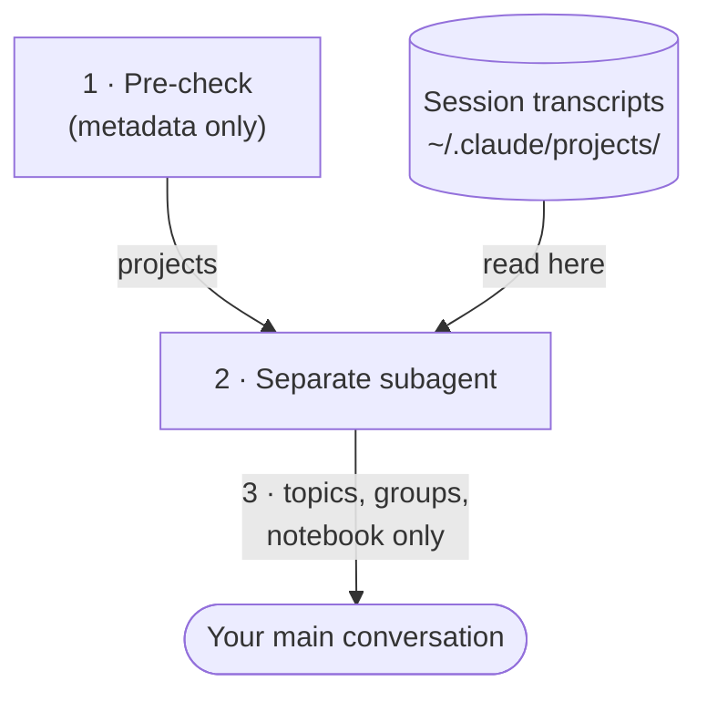

# Coaching in your agent

import ThemedShot from "@site/src/components/ThemedShot";
import { Cards, Card } from "@site/src/components/Cards";
import { Chat, Say } from "@site/src/components/Chat";
import PacingDay from "@site/src/components/PacingDay";

:::tip[Not installed yet?]
Pick a method in **[Installation](../install/index.md)** — it takes about 30 seconds — then come back here.
:::

This is devcoach's main job: **automatic, in-context coaching** while you work with your AI agent. After
your agent finishes a technical task, devcoach appends one short lesson about something that task touched
and you don't know yet — what your knowledge map says you already know is skipped, the rest is pitched at
your level. There's nothing to open and no command to run; it happens in the background.

> The [CLI](./cli.md) and [web dashboard](./web-ui.md) are *secondary* ways to review and manage your
> data — this page is the core experience. See [How it works](../how-it-works.md) for the decision flow
> behind lesson selection.

## Onboarding

The first time your agent connects, devcoach notices your profile isn't set up and walks you through it
inline, after your first task. You can also start it yourself: **`/devcoach:setup`** in the Claude Code
plugin (it first checks that devcoach is running — see
[troubleshooting](../install/claude-code-plugin.md#troubleshooting) if it isn't), or just say *"set up
devcoach"* in any agent. You pick one of four options.

<Cards columns={2}>
  <Card label="Recommended" title="Automatic" to="#automatic-strongly-recommended">Builds your profile in one pass, with no questions, from the stack detected across your local Claude Code history. Conversation text is never read.</Card>
  <Card label="Opt-in" title="Automatic (Deep)" to="#automatic-deep">Also reads real conversation text from your local session transcripts, in a separate subagent, for a finer-grained profile.</Card>
  <Card label="By hand" title="Guided" to="#guided">devcoach asks about each technology you use and how confident you are with it.</Card>
  <Card label="New machine" title="Import backup" to="#import-backup">Give it the path of your backup zip and your whole profile is imported instantly.</Card>
</Cards>

### Automatic (strongly recommended)

**If you already use Claude Code on real projects, choose automatic.** devcoach builds your profile in
one pass, with no questions, from the stack detected across your whole local Claude Code history:

- the projects map;
- manifests and lockfiles (`package.json`, `requirements.txt`, `go.mod`, …);
- activity metadata;
- auto-memory excerpts.

Conversation text is never read. Topics, starting confidence scores, and groups (Languages, Frontend,
DevOps, …) are saved right away; you review and adjust afterwards.

It's the fastest path and gives the most accurate starting profile, which is why it's recommended for
anyone already working in real codebases with Claude.

### Automatic (Deep)

Opt-in variant for a finer-grained profile. It works in three steps:



1. **A metadata-only pre-check** counts the projects active in the last three months. Above eight,
   devcoach asks whether to narrow the window, proceed with the 25 most recent, or pick specific
   projects.
2. **A separate subagent** reads real conversation text from your local session transcripts
   (`~/.claude/projects/`, at most the 5 most recent sessions per project).
3. **Only the result comes back:** the synthesized topics, groups, and notebook. The transcripts never
   enter your main conversation.

Your agent states this trade-off before you choose.

### Guided

Prefer to describe your stack by hand? devcoach asks about each technology and your confidence:

| Confidence | Meaning |
|---|---|
| 1–3 | still learning |
| 4–6 | comfortable |
| 7–9 | strong |
| 10 | expert |

### Import backup

On a new machine? Provide your backup zip path and your whole profile (knowledge map, lessons, settings,
notebook) is imported instantly. See [Backup, export & import](./cli.md#backup-export--import).

### After onboarding

Whichever option you pick, devcoach saves the profile, writes the coaching notebook
(`~/.devcoach/learning-state.md`), and shows a summary grouped by area — ungrouped topics under `Other`:

```
### Languages
- **typescript** — 6/10
- **python** — 4/10

### DevOps
- **docker** — 7/10
- **github_actions** — 6/10

### Other
- **redis** — 3/10

Change any of this later: tell me in chat, use the `devcoach` CLI, or open `devcoach ui`.
```

That profile is your knowledge map. This is how the dashboard (`devcoach ui`) shows one, here with the
documentation's demo data:

<ThemedShot
  alt="The Knowledge Map page of the dashboard: topics grouped by area, each with a confidence bar from 0 to 10"
  light={require("../screenshots/knowledge-map-light.png").default}
  dark={require("../screenshots/knowledge-map-dark.png").default}
/>

Prefer the terminal? `devcoach setup` is an interactive wizard — backup path → automatic or manual
topics → optional groups → daily limit and minimum gap — that you can run any time.

## Your first lesson

You work on a task as normal. After your agent responds, devcoach appends a lesson card as the final text
of the reply:

```
### ──────── 🎓 devcoach ────────

**Promise.allSettled vs Promise.all** · TypeScript · Mid

Promise.all rejects the moment any promise rejects, and you lose the results of the ones that
already succeeded. For independent work, reach for Promise.allSettled… [3–6 short paragraphs]

💡 *Senior tip:* map each task to a `{ ok, value }` / `{ ok, error }` result up front so callers
never have to branch on `status` strings.

### ──────── typescript · mid ────────

Did that land? ✅ knew it (y) · 💡 understood (u) · ❌ couldn't follow (n)
```

## The feedback loop

Answer on the line under the card. A bare `y`, `u` or `n` is enough, and your reply tunes future
coaching:

<Cards columns={3}>
  <Card label="y · yes" title="✅ knew it">You already knew this. Your confidence on that topic goes up by one, and you'll see fewer, deeper lessons there.</Card>
  <Card label="u · got it" title="💡 understood">It was new and it landed. The coach pitched the right level, so nothing changes.</Card>
  <Card label="n · no" title="❌ couldn't follow">Too dense for this session. Confidence stays where it is, and the lesson is kept as a seed for a step-by-step course you can start whenever you like.</Card>
</Cards>

**Anything else, or no reply:** no change. The question is dropped silently and you carry on.

After a ❌ the coach offers that course, once:

<Chat label="Under a lesson card">
  <Say who="coach">Did that land? ✅ knew it (y) · 💡 understood (u) · ❌ couldn't follow (n)</Say>
  <Say who="you">n</Say>
  <Say who="coach">Want a step-by-step course on this? 🎓</Say>
</Chat>

Say yes and it begins right there. [Courses](./courses.md) has the rest.

## The coaching notebook

Every lesson is tied to **where it happened** — project folder, repository, branch, commit — and your agent keeps a **coaching notebook** at `~/.devcoach/learning-state.md`: written at onboarding, refreshed every 10 lessons, and yours to annotate. Flag what didn't click or mark what has sunk in, and the next lessons follow your notes. It stays local and it's optional.

## Sharing a lesson with a teammate

A lesson that landed for you is worth handing over. Ask your agent in plain words:

> share the last lesson · share the lesson about WAL mode as a link · share it as a file

The agent calls `share_lesson` and replies with the card plus a single `devcoach:lesson:1:…` line
(or the link, or writes the `.devcoach.md` file). Paste that anywhere. Only the lesson travels —
project, branch and commit are included only if you ask ("with context"), and a local folder path never
leaves your machine. Your name comes from the `share_name` setting, then git; say "anonymously" to
drop it.

On the receiving end, hand the agent what you were given — the code, the whole card, the link, a URL
or the file's contents — and say **"import this devcoach lesson"**. It joins your log like your own
lessons (feedback works as usual) but never counts against your daily limit; *"show me the lesson Ada
shared"* renders it as a card. With the Claude Code plugin the same flows are one command away:
`/devcoach:share last as link`, `/devcoach:import <code>`. The coach never brings sharing up itself,
except once, right after you star a lesson. Everything else — transports, privacy, the file format —
is in [Sharing lessons](./sharing.md).

## Staying unobtrusive

devcoach is built to stay out of your way, and the pace is yours to set. Two lessons a day is only the
default. Three settings decide how often a lesson can come; this is a day with their defaults:

<PacingDay />

- **Coaching is paced.** A lesson is cued at most once every `nudge_every` interactions (default 10) per
  chat session, and only within the rate limit.
- **Rate limits keep coaching from getting noisy.** By default that is **≤ 2 lessons/day, ≥ 4 hours
  apart** (`max_per_day`, `min_gap_minutes`).

Not what you want? Customize immediately: more aggressive if you want to learn faster, looser if you
prefer fewer interruptions.

Adjust with the terminal:
```bash
devcoach set max_per_day 5           # up to 5 lessons per day
devcoach set min_gap_minutes 60      # as little as 1 hour between lessons
devcoach set nudge_every 5           # cue a lesson every 5 interactions instead of 10
```

Or use the [web dashboard](./web-ui.md) Settings page. Full reference: [Configuration](../reference/configuration.md).

## What to expect

Over a typical work week with 1–2 tasks per day, you'll receive **2–4 lessons aligned to your stack and confidence level.** Each lesson takes 30 seconds to read. After a month of normal AI-assisted development, you'll have built a coaching notebook specific to your gaps — exact patterns you struggle with, edge cases you tend to miss, the reasoning behind tools you reach for instinctively.

**Too intense?** Dial back the frequency: `devcoach set max_per_day 1`. **Want more coaching?** Crank it up: `devcoach set max_per_day 5`. Everything is tunable.

The compounding effect: developers who keep learning while tools get stronger stay in control of the result.

→ Review your progress in the **[CLI](./cli.md)** or the **[web dashboard](./web-ui.md)** — they show the
same data.
