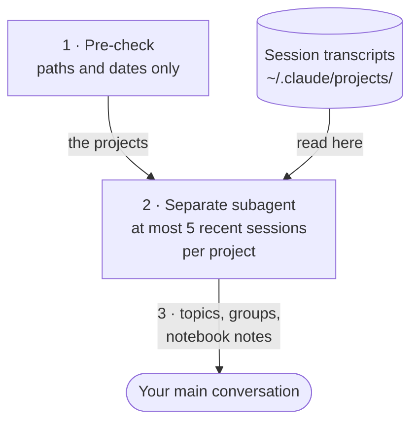

# Coaching in your agent

import { Cards, Card } from "@site/src/components/Cards";
import Clip from "@site/src/components/Clip";
import PacingDay from "@site/src/components/PacingDay";
import Scale from "@site/src/components/Scale";

:::tip[Not installed yet?]
Pick a method in **[Installation](../install/index.md)**, then come back here.
:::

When your agent finishes a task and a lesson is due, devcoach teaches one short lesson on something
that task touched and you don't know yet, pitched at [your level on that topic](../how-it-works.md#depth-calibration).
Whether it comes on its own depends on your agent:

<Cards columns={2}>
  <Card label="On its own" title="Claude Code, Gemini CLI, Codex CLI">
    devcoach's hooks offer setup, then lessons, after a task: nothing to open, no command to run. Gemini CLI and Codex CLI are in beta, and Codex runs the hooks once you trust them.
  </Card>
  <Card label="When you ask" title="Claude Desktop and other MCP agents">
    In Claude Desktop, Cursor, Windsurf, Cline, Continue or Zed, nothing prompts a lesson. Say *set up devcoach* once, then ask after a task.
  </Card>
</Cards>

**In any agent you can ask at any time:** say *coach me* or *teach me something*. Where the devcoach
skill runs (the first three agents), a lesson you ask for comes even when the
[pace](#staying-unobtrusive) would make you wait, and it counts like any other. What each agent gets:
[Installation](../install/index.md).

## Onboarding

Lessons are pitched from your **knowledge map**: the technologies you use, each rated from 0 to 10.
Where lessons come on their own, devcoach offers to build it after your first task and asks you how.
In any agent you can start it yourself: say *set up devcoach*, or run **`/devcoach:setup`** in the
Claude Code plugin, which first checks that devcoach is running
([if it isn't](../install/claude-code-plugin.md#troubleshooting)). The devcoach skill offers four ways:

<Cards columns={2}>
  <Card label="Recommended" title="Automatic" to="#automatic-strongly-recommended">Builds your map in one pass from your recent Claude Code projects, then asks nothing more. You review it afterwards.</Card>
  <Card label="Opt-in" title="Automatic (Deep)" to="#automatic-deep">Also has your agent read your recent Claude Code conversations, in a separate subagent, for a finer map.</Card>
  <Card label="By hand" title="Guided" to="#guided">A short conversation about each technology you use and how confident you are with it.</Card>
  <Card label="New machine" title="Import backup" to="#import-backup">Give the path of a devcoach backup zip, and your map, lessons and the rest come back.</Card>
</Cards>

Whichever way you pick, your agent saves the map, writes the coaching notebook
(`~/.devcoach/learning-state.md`) and shows a summary grouped by area, with ungrouped topics under
`Other`:

```
### Languages
- **typescript** — 6/10
- **python** — 4/10

### DevOps
- **docker** — 7/10
- **github_actions** — 6/10

### Other
- **redis** — 3/10

Change any of this later: tell me in chat, use the `devcoach` CLI, or open `devcoach ui`.
```

To adjust it, tell your agent (*set my Python confidence to 7*), use the [CLI](./cli.md), or press
**Edit** on the Knowledge Map page of the [web dashboard](./web-ui.md):

<Clip
  alt="The dashboard's Knowledge Map: Edit is pressed, the plus beside django raises it from 3 (red) to 4 (yellow), and Done leaves edit mode"
  mp4={require("../clips/knowledge-edit.mp4").default}
  webm={require("../clips/knowledge-edit.webm").default}
  poster={require("../clips/knowledge-edit.png").default}
  width={1640}
  height={1026}
  caption="Each topic's bar runs from 0 to 10. In edit mode, − and + move it one point."
/>

Prefer the terminal? `devcoach setup` is an interactive wizard (backup path, automatic or manual
topics, optional groups, daily limit and minimum gap) that you can run any time.

### Automatic (strongly recommended)

**If you already use Claude Code on real projects, choose this.** devcoach scans your 15 most recently
active Claude Code projects: their dependency lists (`package.json`, `requirements*.txt`,
`pyproject.toml`) and file names, how much you work in each, and Claude Code's auto-memory notes. It
counts your prompts and keeps none of their text. Your agent saves the topics, their starting
confidence and groups (Languages, Frontend, DevOps, …) right away; you review them afterwards.

No Claude Code history on this machine, say a new computer, or you work in Gemini CLI or Codex CLI? It
starts from the current project and devcoach's general map, which adjusts as you work. What the scan
reads, exactly: [Privacy & security](../reference/privacy.md#what-devcoach-reads).

### Automatic (Deep)

For a finer map, your agent also reads what you discussed with Claude Code. It states this trade-off
before you choose:



If more than eight projects were active in the last three months, the pre-check asks whether to narrow
the window, take the 25 most recent, or pick projects. The devcoach skill tells the subagent to send back
only what step 3 shows; what it reads goes to your agent's model
([Privacy & security](../reference/privacy.md#what-devcoach-reads)).

### Guided

Your agent asks about each technology you use and how confident you are with it: 1–3 *still
learning*, 4–6 *comfortable*, 7–9 *strong*, 10 *expert*. Once the list is complete it proposes groups.

### Import backup

On a new machine? Give the path of your devcoach backup zip: your settings, knowledge map, lessons,
notebook and courses are restored. What a restore keeps and replaces is in
[Configuration](../reference/configuration.md#backup-strategy).

## Your first lesson

You work on a task as normal. When a lesson is due, your agent ends its reply with a lesson card:

```
### ──────── 🎓 devcoach ────────

**Promise.allSettled vs Promise.all** · TypeScript · Mid

Promise.all rejects the moment any promise rejects, and you lose the results of the ones that
already succeeded. For independent work, reach for Promise.allSettled… [3–6 short paragraphs]

💡 *Senior tip:* map each task to a `{ ok, value }` / `{ ok, error }` result up front so callers
never have to branch on `status` strings.

### ──────── typescript · mid ────────

Did that land? ✅ knew it (y) · 💡 understood (u) · ❌ couldn't follow (n)
```

Each lesson is saved with where it happened: project folder, repository, branch and commit. Now and
then Claude Code also shows *🎓 devcoach: checking whether a lesson is due…* next to a generic *Stop
hook error occurred*: that is devcoach asking for the lesson, and it is harmless
([Troubleshooting](../troubleshooting.md)).

## The feedback loop

Answer on the line under the card. A bare `y`, `u` or `n` is enough:

<Cards columns={3}>
  <Card label="y · yes" title="✅ knew it">You already knew this. If the topic is rated below the lesson's level, it goes up one point, so its next lessons go deeper.</Card>
  <Card label="u · got it" title="💡 understood">It was new and it landed: the level was right. Nothing changes now.</Card>
  <Card label="n · no" title="❌ couldn't follow">Too dense for this session. Nothing changes now; the lesson is kept as the seed of a step-by-step course.</Card>
</Cards>

**Anything else, or no reply:** nothing is recorded, and you carry on.

<Scale
  bands={[
    { from: 0, to: 3, label: "junior", tone: "low" },
    { from: 4, to: 6, label: "mid", tone: "mid" },
    { from: 7, to: 9, label: "senior", tone: "high" },
  ]}
  marks={[
    { at: 6, label: "docker today: mid lessons" },
    { at: 7, label: "after ✅ on a senior one: senior lessons" },
  ]}
  caption="Your confidence in a topic sets the level of its lessons (at 10, only cutting-edge ones). ✅ on a lesson above your rating moves the topic up one point."
/>

**Later, at a notebook checkpoint,** the coach looks at your last ten lessons and may move a topic one
point: up when its answers were all ✅ or 💡, down when it had two or more lessons and a ❌.

**After a ❌** the coach offers that course, once: say yes and it begins right there
([Courses](./courses.md)). To change an answer, use the lesson's page in the
[web dashboard](./web-ui.md) (✓ / 💡 / ✗) or `devcoach feedback <id> know|understood|dont_know`;
moving off ✅ takes its point back.

## The coaching notebook

Your agent keeps notes on how you learn in `~/.devcoach/learning-state.md`. It writes them at onboarding
and updates them at notebook checkpoints. The file is yours to edit, in any editor or on the
dashboard's Settings page: note what didn't click or what has sunk in, and later lessons take it into
account.

## Sharing a lesson with a teammate

Ask your agent to *share the last lesson*: you get text, a link or a `.devcoach.md` file to pass on, with
your name unless you share anonymously. For a lesson you were given, say *import this devcoach lesson*;
it never counts against your daily limit. The rest is in [Sharing lessons](./sharing.md).

## How often lessons come {/* #staying-unobtrusive */}

devcoach is built to stay out of your way, and the pace is yours to set. This is a day with the
defaults:

<PacingDay />

- **Each reply your agent finishes is one interaction.** In Claude Code and Codex CLI, plan-mode
  replies don't count. A cue comes after a set number of them in one chat, so a short chat can end
  without a lesson.
- **The daily cap counts any 24 hours**, not the calendar day, and the gap keeps two cued lessons
  apart.
- **While a course is in progress,** lesson cues pause.

To change the pace from a terminal:

```bash
# Fewer: one in any 24 h (the least)
devcoach set max_per_day 1
# Sooner: a cue after 5 interactions
devcoach set nudge_every 5
# Many short chats: add them up
devcoach set nudge_scope global
```

Or ask your agent (*set my max lessons per day to 3*), or use the Settings page of the
[web dashboard](./web-ui.md). Every setting, its range and the exact rules are in
[Configuration](../reference/configuration.md#rate-limits).

Review your lessons and your map in the [CLI](./cli.md) or the [web dashboard](./web-ui.md): they show
the same data.
