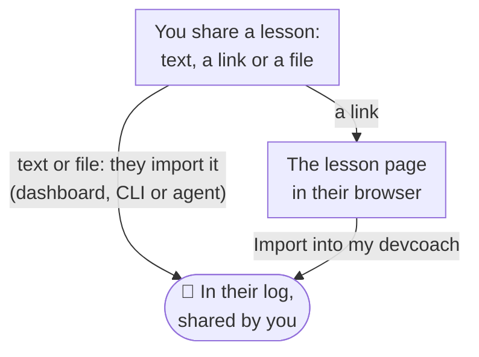

import { Card, Cards } from "@site/src/components/Cards";
import Clip from "@site/src/components/Clip";
import ShareCode from "@site/src/components/ShareCode";
import Terminal from "@site/src/components/Terminal";
import ThemedShot from "@site/src/components/ThemedShot";
import Tabs from "@theme/Tabs";
import TabItem from "@theme/TabItem";
import cli from "@site/src/data/cli-output.json";

# Sharing lessons

A lesson that landed for you is often exactly what a teammate is missing. devcoach lets you hand one
over without any account or server: the lesson itself travels, in a form the receiver can paste, click
or drop wherever they use devcoach, and it joins their coaching log as a lesson shared by you.



## Three ways to hand a lesson over

Every transport carries the same payload; the receiver never has to know which one you used.

<Cards columns={3}>
  <Card label="Paste" title="Copyable text">

The lesson card as markdown, then one `devcoach:lesson:1:…` line.

**Best for** chat, issues, email: paste the whole thing; devcoach finds the code.

  </Card>
  <Card label="Click" title="Link">

<p><code>https://<wbr />ultimaphoenix.github.io/<wbr />dev-coach/<wbr />lesson#<wbr />devcoach:lesson:1:…</code></p>

**Best for** messaging: the receiver reads the lesson in the browser and imports it with one click.

  </Card>
  <Card label="Drop" title=".devcoach.md file">

`<lesson-id>.devcoach.md`, YAML front matter + the markdown body.

**Best for** pull requests, wikis, repos: renders on GitHub, opens in any editor.

  </Card>
</Cards>

The text and the link carry the lesson as a code; the file spells the same payload out as front
matter. A share is a plain string or file that you hand over yourself: nothing is uploaded anywhere.

<ShareCode />

## What travels — and what never does

Whatever the transport, a share is one small JSON document. Here is a real one: `devcoach share --last`
on the demo data, with the name *Alex*, decoded by devcoach's own decoder. The highlighted lines are
the ones beyond the lesson itself.

```json title="A share, decoded (the TL;DR and the body shortened here)" {12-18}
{
  "format": "devcoach.lesson",
  "version": 1,
  "lesson": {
    "title": "Cache stampede — when every server hits the DB at the same moment",
    "summary": "A cache stampede happens when a popular key expires and…",
    "body": "Imagine a cache key that covers your most-viewed product page…",
    "topic_id": "redis_cache_stampede",
    "categories": ["redis", "performance_optimization", "software_architecture"],
    "level": "senior"
  },
  "origin": {
    "id": "lesson-redis-cache-stampede-001",
    "timestamp": "2026-04-28T10:00:00Z"
  },
  "shared_by": "Alex",
  "shared_at": "2026-11-22T04:19:33Z",
  "app_version": "2.7.1"
}
```

| When | What travels |
|---|---|
| **Always** | The lesson: title, TL;DR (`summary`), body, topic, categories, level. Its id and the date you got it (`origin`). The date you shared it (`shared_at`) and your devcoach version (`app_version`). |
| **By default** | Your name (`shared_by`), unless you remove it: see [Your name](#your-name) below. |
| **On request** | Where it happened: the task, project, branch and commit, plus the repository and its host when it is on GitHub, GitLab or Bitbucket. You ask with *Include where it happened* (dashboard), `--with-context` (terminal) or *with context* (your agent). |
| **Never** | The local folder path, with or without context. Your answer under the lesson (✓ 💡 ✗) and its star. |

<details>
<summary>What context adds: the same lesson, shared with context</summary>

```json title="devcoach share --last --with-context: the lesson part (unchanged keys left out)"
"lesson": {
  "title": "Cache stampede — when every server hits the DB at the same moment",
  "level": "senior",
  "task_context": "Debugging a production incident where Redis cache expiry caused database overload spikes",
  "project": "dev-coach",
  "repository": "developer/dev-coach",
  "branch": "main",
  "commit_hash": "d3ae15d8041a1c0f421834ef8cb5b83f10d7d851",
  "repository_platform": "github"
}
```

This lesson is stored with the folder it was taught in, `~/development/claude-projects/dev-coach`.
That path is not in the share. The repository travels only when its remote is on github.com,
gitlab.com or bitbucket.org; a remote anywhere else (a company Git server, a path on your disk) stays
out, even with context.

</details>

### Your name

A share carries your name unless you remove it. devcoach takes it from the `share_name` setting, else
from your git `user.name`; with neither, the share goes without a name. The receiver sees *shared by*
that name. The dashboard shows it in an editable field before you copy anything; the terminal and your
agent use it without asking.

| Where | To send no name, or another one |
|---|---|
| Dashboard | Clear the *Your name* field, or type another name. What you type becomes your `share_name`. |
| Terminal | Add `--anonymous`, or `--by "<name>"` (it becomes your `share_name` if none is set). |
| Your agent | Say *anonymously*, or say the name to use. The agent offers once to remember a new name, never silently. |

There is no setting that makes every share anonymous: an empty `share_name` means "use git
`user.name`". The terminal says *Shared anonymously* when a share goes without a name.

:::info[The link is server-less]

The lesson sits in the URL fragment (after `#`), which browsers never send to the site. The page
decodes it locally; the only request it makes is a best-effort `GET /ping` to your own dashboard on
`127.0.0.1` to say whether it is running. That check needs a one-time *Local network access*
permission in Chrome 142+ and is not possible at all in Safari (see [Troubleshooting](#troubleshooting)).
**Import** works whenever your dashboard is running, whatever the check says.

:::

See [Privacy & security](../reference/privacy.md#sharing-is-explicit) for the full statement.

## From the dashboard

<Clip
  alt="The Lessons page: hovering a row shows ↗ at its end; a click opens the share panel next to the row, with the name Alex, an Include where it happened checkbox, Copy text, Copy link and Download .md; Copy link turns into Copied"
  mp4={require("../clips/share-lesson.mp4").default}
  webm={require("../clips/share-lesson.webm").default}
  poster={require("../clips/share-lesson.png").default}
  width={1640}
  height={922}
/>

Open a lesson and click **↗ Share**, or hover a row on the Lessons page and click the `↗` that appears
at its end: the same panel opens next to the row, so you never leave the list. The panel shows your
name, an *Include where it happened* checkbox (off by default) and three actions: **Copy text**,
**Copy link**, **Download .md**.

## From the terminal

```bash
devcoach share --last                 # card + code line → paste anywhere
devcoach share <id> --link            # the share link
devcoach share <id> --file            # writes <id>.devcoach.md
devcoach share <id> --with-context    # also project / branch / commit / task
devcoach share <id> --by "Ada"        # sender name (remembered as share_name if none is set)
devcoach share <id> --anonymous       # no sender name
```

What **Copy text** and `devcoach share` produce: the card people can read, then the one line
devcoach reads (shortened here; a real code is one line of about 1,500 to 2,500 characters):

```text
### ─────────── 🎓 devcoach ───────────
**Docker layer caching — why COPY order decides your build speed** · docker · infrastructure · Junior

Every `RUN`, `COPY`, and `ADD` instruction in a Dockerfile creates a new layer. Docker caches each
layer by its content hash; if the hash matches what's already on disk, it reuses the cached result…

Shared by Ada with devcoach — paste it to your agent or run: devcoach import
devcoach:lesson:1:dVZdbhs3EL7KYAskgKBd_RhNEeXJqBugaBsXtougqQsvtaQk2rvkluRKWQQBeoai70Wv1hP0CPmGS…
```

Paste the whole thing anywhere: chat, an issue, an email. The receiver never has to find the code
in it: every importer does.

## From your agent

Ask in plain words: *"share the last lesson"*, *"share the lesson about WAL mode as a link"*, *"share it
as a file, anonymously"*. The agent calls the `share_lesson` tool and replies with the card and the
code in a fenced block (or the link, or writes the file). With the Claude Code plugin, `/devcoach:share`
does the same: `/devcoach:share last as link`, `/devcoach:share about docker with context`.

The coach never offers to share on its own, with one exception: right after you **star** a lesson,
it asks once whether you want to hand it to a teammate.

## Receiving a lesson

Every way in leads to the same place: the lesson joins your log, attributed to the sender.

### In the dashboard

<Clip
  alt="Importing in the dashboard: ＋ Import opens a box, a code is pasted and imported; the lesson page shows Imported, shared by Sam, and the list now has the new lesson on top with the sender's name"
  mp4={require("../clips/import-lesson.mp4").default}
  webm={require("../clips/import-lesson.webm").default}
  poster={require("../clips/import-lesson.png").default}
  width={1640}
  height={922}
/>

**＋ Import** on the Lessons page: paste the code, the link, a URL whose body is a shared lesson (a raw
gist, a file in a repo), or the whole copied card; pick a `.devcoach.md`; or **drop the file anywhere**
on the page. For a URL, devcoach downloads that one page (public hosts only, at most 256 KB).

### From a link

The share page shows the lesson and, when your dashboard is running, **Import into my devcoach** opens
a preview on `127.0.0.1` with a single **Add to my lessons** button. Nothing is saved until you click
it. The page also offers **Copy code** and **Download .devcoach.md**.

<Tabs>
  <TabItem value="link" label="1 · The link opens" default>
    <ThemedShot
      alt="The share link's page on the docs site: the lesson rendered, and Import into my devcoach when a dashboard is running"
      light={require("../screenshots/lesson-link-page-light.png").default}
      dark={require("../screenshots/lesson-link-page-dark.png").default}
    />
  </TabItem>
  <TabItem value="preview" label="2 · Preview in the dashboard">
    <ThemedShot
      alt="Shared lesson preview in the dashboard, with a single Add to my lessons button"
      light={require("../screenshots/lesson-import-preview-light.png").default}
      dark={require("../screenshots/lesson-import-preview-dark.png").default}
    />
  </TabItem>
  <TabItem value="imported" label="3 · Imported">
    <ThemedShot
      alt="The lesson page right after the import, with the confirmation banner and the shared-by line"
      light={require("../screenshots/lesson-imported-light.png").default}
      dark={require("../screenshots/lesson-imported-dark.png").default}
    />

*This capture shows another shared lesson, WAL mode from Ada: the banner and the shared-by line are the same for every import.*

  </TabItem>
</Tabs>

### In the terminal

`devcoach import` with no argument reads your clipboard; otherwise pass the code, the link, a URL, a
file path, or `-` for stdin. The same import from the terminal, twice. The second time, devcoach
recognises the share:

```text
$ devcoach import ~/Downloads/lesson-docker-layer-cache-001.devcoach.md
✓ Imported "Docker layer caching — why COPY order decides your build speed" (shared by Ada) as lesson-docker-layer-cache-001 — topic docker_layer_caching
Topic 'docker_layer_caching' is not in your knowledge map — track it with: devcoach knowledge-add docker_layer_caching

$ devcoach import ~/Downloads/lesson-docker-layer-cache-001.devcoach.md
Already in your log as lesson-docker-layer-cache-001 (shared by Ada)
Topic 'docker_layer_caching' is not in your knowledge map — track it with: devcoach knowledge-add docker_layer_caching
```

### In your agent

Hand it whatever you were given and say *"import this devcoach lesson"* (plugin:
`/devcoach:import <code or link>`). Then *"show me the lesson Ada shared"* renders it as a card.

## How an imported lesson behaves

<Tabs>
  <TabItem value="list" label="In the list" default>
    <ThemedShot
      alt="The Lessons page filtered to shared lessons: the sender's name under the topic"
      light={require("../screenshots/lessons-shared-light.png").default}
      dark={require("../screenshots/lessons-shared-dark.png").default}
    />
  </TabItem>
  <TabItem value="lesson" label="The lesson">
    <ThemedShot
      alt="A shared lesson: the card with a shared-by line, feedback buttons, no local context"
      light={require("../screenshots/lesson-shared-light.png").default}
      dark={require("../screenshots/lesson-shared-dark.png").default}
    />
  </TabItem>
</Tabs>

It appears in your log with a **🤝 shared by** line and can be filtered with
`devcoach lessons --imported` / `--from <name>`, `get_lessons({imported: true})` /
`({shared_by: "<name>"})`, or the dashboard's **🤝 Shared** filter:

<Terminal command="devcoach lessons --imported" output={cli.lessonsImported} />

- Its **topic counts as taught**, so the coach will not teach it again, and **✓ / 💡 / ✗ feedback
  works** as for your own lessons. If the topic is not in your knowledge map yet, you are offered to track it.
- It **never counts against your daily limit** or the minimum gap, and never resets the pacing.
- Importing the same share twice reports *already in your log*; the same lesson from a different
  sender is stored as a separate lesson.

:::note[Someone else's text is stored inert]

Terminal escape sequences and control characters (a screen clear, a hidden link, a clipboard write, a
right-to-left override) are removed on import, and the CLI strips them again before it prints any
lesson.

:::

## The `.devcoach.md` format

```markdown title="wal-mode-readers.devcoach.md"
---
format: devcoach.lesson
version: 1
title: "WAL mode: readers never block writers"
topic_id: sqlite
level: mid
categories: [sqlite, node]
summary: "In WAL mode SQLite appends changes to a write-ahead log, so readers keep reading the last committed snapshot."
origin_id: wal-mode-readers
origin_timestamp: 2026-09-10T10:00:00Z
shared_by: "Ada"
shared_at: 2026-09-14T09:30:00Z
app_version: 2.1.0
---

SQLite's default rollback journal locks the whole database for a write…

💡 *Senior tip:* enable WAL once per database file — it persists.
```

A `.devcoach.md` is a markdown file with YAML front matter: readable by people, renderable on GitHub,
and importable by any devcoach. Other tools can write it too; the parser accepts JSON-quoted strings,
flow lists (`[a, b]`) and `null`.

Optional keys, present only when context was included: `task_context`, `project`, `repository`,
`branch`, `commit_hash`, `repository_platform`. `folder` is never written.

## Troubleshooting

| Symptom | Cause | Fix |
|---|---|---|
| *This lesson code is damaged or incomplete* | A character of the code was changed: an email client wrapped it, a chat trimmed it, a model retyped it | Copy the whole text again; devcoach re-joins wrapped lines, but not edited characters |
| *too large to be a lesson* | The code is bigger than a real lesson (64,000 characters / 256 KB decoded) | Ask the sender for the `.devcoach.md` file instead |
| *shared by a newer devcoach* | The sender runs a newer share format | Update devcoach the way you installed it (see [Installation](../install/index.md)), for example `npm i -g devcoach@latest` or `brew upgrade devcoach` |
| *Only public http(s) URLs can be imported* | The URL points at localhost, a private network or a link-local address | Copy the lesson text instead of the URL |
| The link page says no dashboard answered | The dashboard is not running, or runs on another port | Start it (`devcoach ui`, `/devcoach:ui`) or set the port in the panel, then *retry the check*; the Import button works either way |
| Safari says it can't check my dashboard | Safari (WebKit) blocks the background request an https page would make to `http://127.0.0.1`, so the page skips the check. Nothing is wrong | If the dashboard is running, **Import** works as usual: it opens your dashboard as a normal link. Otherwise use **Copy code** or **Download .devcoach.md** |
| Chrome asked to allow local network access, or the page says the browser blocks it | Chrome 142+ asks once before a website may reach `127.0.0.1` | Allow it (icon left of the address bar → *Local network access*), then *retry*; **Import** works whatever the answer |
| The link page hides the Import button | The code is longer than a URL Node's dashboard accepts (~12,000 characters) | Use **Copy code** or **Download .devcoach.md** and import that |
